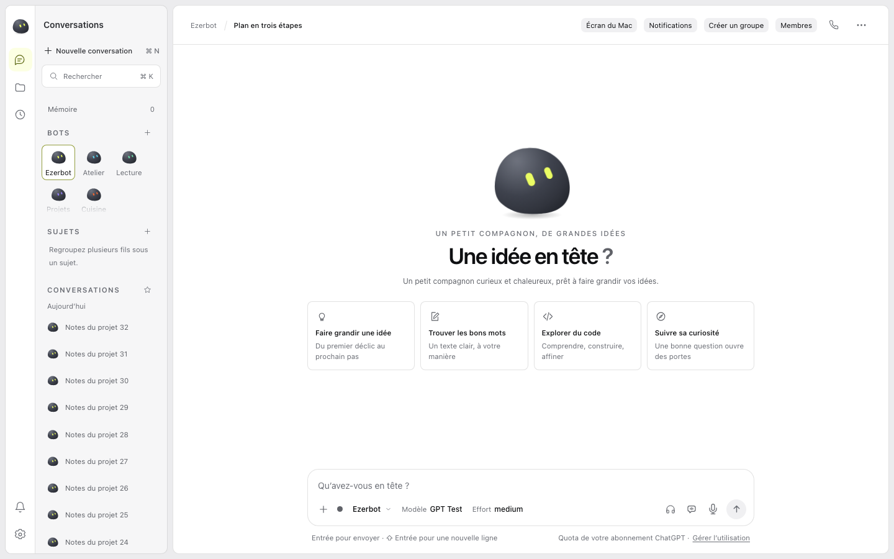
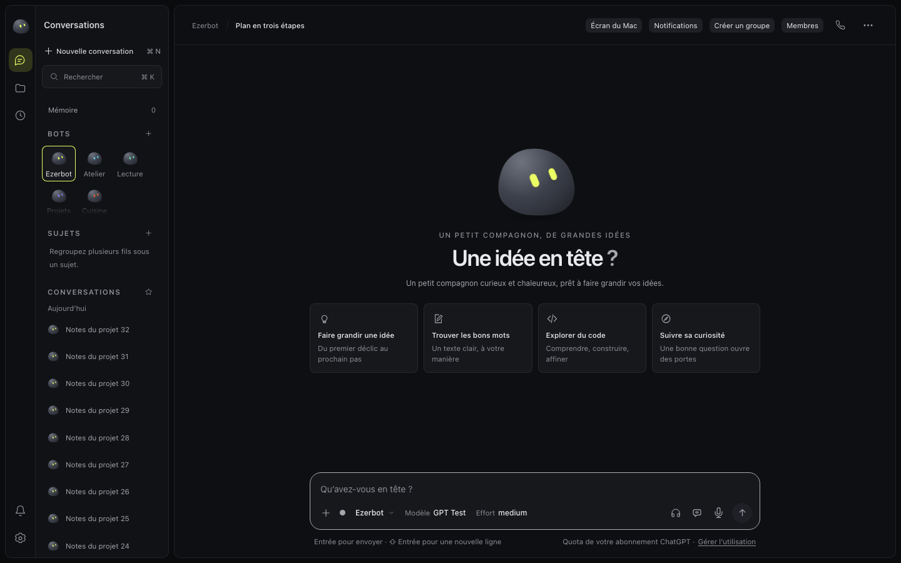
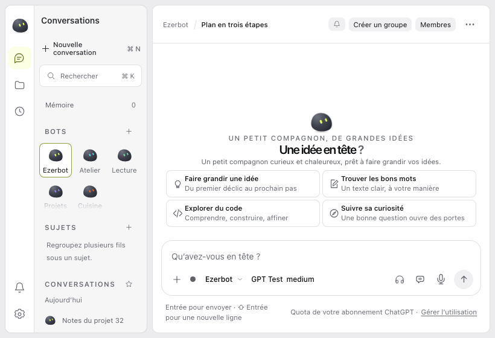
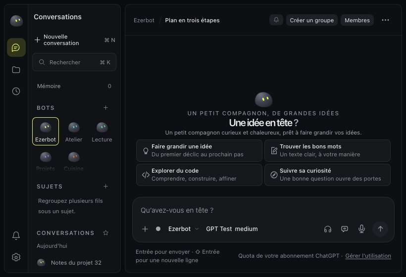
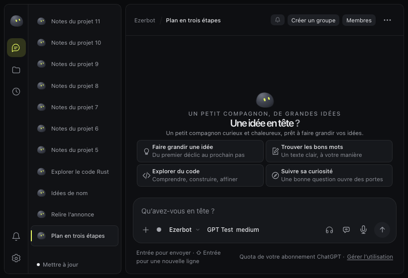

# Preuves Mac du rail Galet, ronde 2

PR587, ticket561. Tête produit 7118a6e4a518a7bd1330d02df8a251dcaa70d91c. Ce paquet de preuves est séparé du code produit.

La mise à jour disposait d'un montage implicite dans le parent de Réglages. Le rail de 48 px recevait donc des libellés et des erreurs trop larges. La coque possède maintenant un hôte explicite sous la liste défilante, dans la seconde colonne. Notifications et Réglages restent fixes.

Le test rouge sur le binaire R1 échoue dans les quatre couples taille et thème. Le rejeu ciblé passe avec 8 tests. Le lot complet final passe avec 425 tests, zéro échec, annulation, test sauté ou todo. select-bot.test.cjs est inchangé. Les deux checks CI compile réussissent sur la tête produit.

Le parcours Mac compte 20 contrôles du rail et 48 contrôles des mises à jour, avec 12 apply simulés. Il couvre les vraies destinations, les raccourcis, les bots, Mémoire, Pages, la liste longue et les états de mise à jour. La création d'un bot puis l'envoi par Entrée aboutissent à un message echoed. Une Page réelle est créée dans un lancement distinct.

Les 32 captures R2 ont un reçu de viewport et d'IHDR lié à leur SHA-256 et au SHA produit. Elles comprennent les quatre vues latérales, les trois états principaux, le défilement, les destinations, la création et Pages. Aucun ancien PNG n'est recyclé comme preuve de R2. Les quatre avant et le board sont des références explicitement séparées.

Les trois Cleanup Mac sont contrôlés, y compris celui de la tentative de pilote échouée. Les HOME jetables et le HOME de contrôle sont supprimés. Aucun processus attribué ne reste. Aucun run.json, marqueur d'authentification, profil, base ou secret n'est publié. Aucune mise à jour réelle, aucun téléchargement, aucune installation et aucune invite macOS ne sont utilisés par le parcours.

- [Inventaire des montages et contrôles](mounts-and-tests.md).
- [Comparaison et limites](comparison.md).
- [Rouge sur R1](red-buttons.log), [identité du binaire et des assets](red-receipt.json), [vert ciblé](green.log).
- [425 tests terminés](final-tests.log), [reçu du SHA et du journal](final-tests-receipt.json), [commande](final-tests-command.sh).
- [Contrôles des mises à jour](updates-checks.json), [rail](rail-checks.json), [création](creation-checks.json).
- [Dimensions et hashes de tous les PNG](receipts/png-dimensions.json), [Cleanup](cleanup-audit.json), [CI](ci.json).
- [Essais échoués conservés](attempts/) et [pilotes rejouables](replay/).

Les deux reports des parcours aboutis portent PASS 7118a6e4a518a7bd1330d02df8a251dcaa70d91c. Ce résultat est celui de l'owner. La revue canonique est réservée au coordinateur. Aucun verifier, pret ou codex-review n'a été lancé par l'owner. Aucune fusion ni auto-merge.

principle-fix-root-causes motive le déplacement du montage. principle-test-behavior-not-implementation motive les rectangles et les interactions. principle-prove-it-works motive la nouvelle preuve sur la tête exacte et le contrôle des fichiers servis.

## Captures latérales finales

## Mise à jour disponible, progression et erreur

| État | Clair 1440×900 | Sombre 1440×900 | Clair 820×560 | Sombre 820×560 |
| --- | --- | --- | --- | --- |
| Disponible | [Image](final-v2/updates/light-disponible-1440x900.png) | [Image](final-v2/updates/dark-disponible-1440x900.png) | [Image](final-v2/updates/light-disponible-820x560.png) | [Image](final-v2/updates/dark-disponible-820x560.png) |
| Téléchargement simulé | [Image](final-v2/updates/light-telechargement-1440x900.png) | [Image](final-v2/updates/dark-telechargement-1440x900.png) | [Image](final-v2/updates/light-telechargement-820x560.png) | [Image](final-v2/updates/dark-telechargement-820x560.png) |
| Erreur simulée | [Image](final-v2/updates/light-erreur-1440x900.png) | [Image](final-v2/updates/dark-erreur-1440x900.png) | [Image](final-v2/updates/light-erreur-820x560.png) | [Image](final-v2/updates/dark-erreur-820x560.png) |

