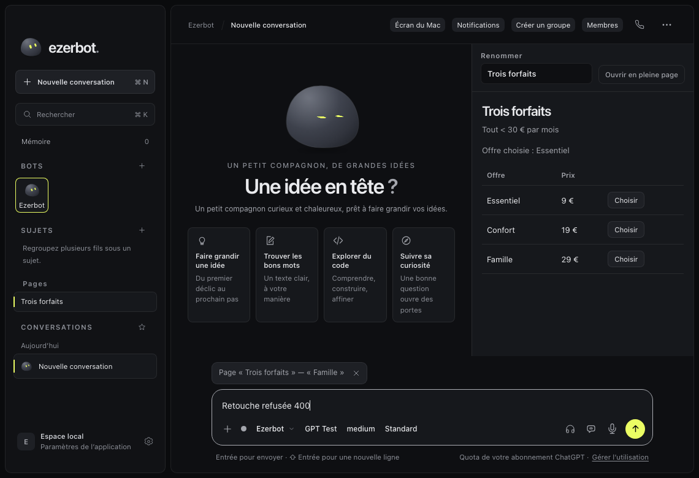
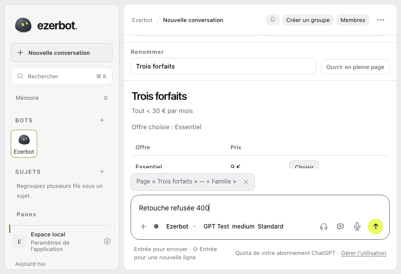

# Preuves du ticket 294, ronde 12

Tête exacte `7427e46b36ee558878440fead366c74c511b778e`, publiée et worktree propre. [PR 335](https://github.com/charlescstpierr/ezerbot/pull/335).

Le correctif ajoute cinq lignes à onState dans pages.js. Une citation remplacée pendant la création du fil reste avec le brouillon après un refus 400. Le réessai emporte la nouvelle ancre. Aucun transfert générique, tentative persistée ou changement des fonctions retirées en r11.

Le test est commité avant le correctif. [Rouge réel](red.log), 54/56, deux échecs sur la nouvelle puce cachée. [Reçu de base](red-receipt.json). [Vert ciblé](green-before-merge.log), 56/56. Les réponses HTTP du test sont des instantanés clonés indépendants. Le correctif produit ne touche que onState. Un merge normal de main était nécessaire pour résoudre le conflit du bundle chat.js, reconstruit avec npm run build.

[Suite Node initiale](node.log), 1 124 réussites et deux annulations par délai dépassé dans shell-stop.test.js. [Suite complète séquentielle](node-serial.log), 1 126/1 126, aucun échec, annulation, skip ou todo. Les assertions et délais sont identiques. [Rust Pages](rust.log), 34/34, aucun test ignoré ou filtré. [Build web](web-build.log) et [build du wrapper](launch.log), sorties 0. Les deux jobs CI compile sont verts, voir [reçu distant](remote.json). [Gitleaks](gitleaks.log) ne détecte aucune fuite avant le push produit.

[Commandes reproductibles](commandes.md), [résultats structurés](checks.json) et [diff total de PR](stat.txt). Le diff complet reste au-delà du critère initial d’environ 300 lignes. La portée R12 avant merge est limitée à deux fichiers, 33 ajouts et cinq retraits, dont cinq lignes de produit.

[Preuve owner PASS](final/report.md), [parcours réel](final/cases.json) et [inspection visuelle](final/visual-inspection.md). La Page a perdu son fil d’origine dans le serveur isolé. Le navigateur suspend la création du nouveau fil, remplace Confort par Famille puis simule un refus 400. Famille reste visible et part dans page_anchor au réessai. Les non-régressions de plusieurs cellules, espaces, accusé tardif et renommage passent aussi.

Les six [captures](final/spheres/pages) ont été inspectées. Les refus sont capturés en clair et sombre à 1140×780 et 820×560. La comparaison visuelle utilise les captures Galet du dépôt. Les corpus evidence et formatted manquants restent non comparés et aucun appariement automatique pixel à pixel n’est revendiqué.

[Doctor avant](final/doctor-before.log) et [après](final/doctor-after.log) confirment le binaire exact. [Sockets](final/network-loopback.log) du wrapper et du faux fournisseur uniquement sur loopback. [Cleanup](final/cleanup.json) confirme auth, wrapper, fake, Chrome et le seul pont pm-i294 arrêtés, HOME jetable supprimé. Le garde conserve les contrôles d’identité du Cleanup de main. Aucun secret, run.json ou profil utilisateur publié.

principle-fix-root-causes a placé la correction avant choose. principle-model-the-domain a conservé quote et orphan. principle-prove-it-works a imposé le rouge réel, le parcours du binaire final et son nettoyage. Les trois fiches ont été lues. Cette preuve owner ne remplace pas le vérificateur indépendant. Verifier et pret restent au coordinateur, sans fusion par l’owner.
