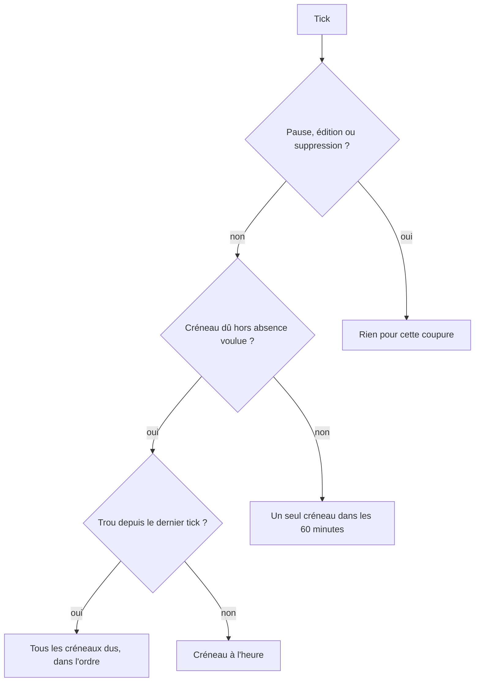
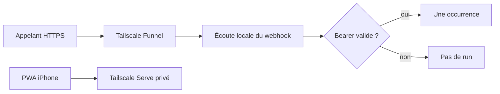

# Routines — rattrapage au réveil et déclencheurs

Spec issue du grill du 21 octobre 2026. Elle décrit le comportement visible sur le Mac. Les tickets d’implémentation sont des issues ; cette page est la source des décisions.

Vocabulaire déjà en usage dans le produit : routine, bot, occurrence, créneau, rattrapage, manquée, pause, lancement manuel, fuseau, agent en arrière-plan. Un déclencheur est ce qui fait partir une routine. Un groupe est un déclencheur composé de plusieurs déclencheurs simples.

## Contexte

Aujourd’hui une routine a un corps (prompt libre ou skill épinglée) et un horaire : cron à cinq champs, alias `@hourly` à `@annually`, `@every` avec phase optionnelle, date unique, fuseau IANA. Le panneau permet de créer, modifier, mettre en pause, reprendre, lancer maintenant et lire l’historique. L’historique distingue En attente, En cours, Terminée, Manquée et Échec, et sépare un lancement manuel d’un créneau planifié.

Deux façons de faire partir l’horaire existent déjà. L’application ouverte ticke. Un agent launchd, activé dans Paramètres après une approbation, vérifie les échéances chaque minute quand l’application est fermée, ouvre le moteur seulement si une routine est due, puis s’arrête. Il ne tourne pas quand le Mac est éteint ou en veille.

La règle visible aujourd’hui est : au retour, un seul rattrapage dans les 60 dernières minutes ; les autres créneaux sont marqués manqués ; une pause ne se rattrape pas. Une édition d’horaire ne rejoue pas un créneau déjà servi. Une date unique dépassée avant confirmation reste à reprogrammer.

Il n’existe ni webhook, ni déclencheur GitHub, courriel ou calendrier, ni groupe. La PWA iPhone passe par Tailscale Serve sur le HTTPS privé du tailnet. Cette publication reste privée : elle n’ouvre pas l’application sur Internet.

## Énoncé du problème

Quand le Mac est éteint ou en veille, les créneaux dus ne partent pas. Au réveil, la fenêtre de 60 minutes en marque la plupart manqués. L’utilisateur perd le travail qu’il avait programmé.

Les routines ne peuvent pas non plus partir sur un fait extérieur : un appel HTTP, une pull request, un courriel, un événement d’agenda. Un service qui voudrait appeler le Mac ne peut pas l’atteindre derrière un NAT sans ouvrir un port sur la box.

## Solution

Au réveil, les créneaux dus pendant l’extinction ou la veille sont exécutés, dans l’ordre, lorsque l’utilisateur avait demandé que les routines tournent. La fenêtre de 60 minutes reste pour le cas où le Mac était allumé et où rien n’était chargé de tourner.

Les déclencheurs ajoutés, sur le modèle utile de Grok Bot retenu au grill, sont : l’horaire déjà là, un webhook authentifié par jeton Bearer, les événements GitHub nommés ci-dessous, un nouveau courriel, un événement de calendrier, et un groupe. GitHub, le courriel et le calendrier consomment des événements de connecteur. Le webhook est publié par Tailscale Funnel, chemin dédié, sans exposer la PWA.

## Décisions

Grill du 21 octobre 2026.

1. **Extinction et veille.** Les créneaux dus pendant que le Mac ne pouvait pas ticker sont rattrapés au prochain tick qui suit le réveil ou le démarrage. Un mode cloud pourra un jour exécuter à la place du Mac. Il est hors périmètre. L’identité d’occurrence reste réclamable par un exécuteur futur, donc ce mode n’est pas fermé.
2. **Déclencheurs.** Horaire (inchangé dans sa grammaire), webhook Bearer, GitHub, courriel, calendrier, groupe. GitHub, courriel et calendrier dépendent de `docs/specs/connecteurs.md`, en cours de rédaction. GitHub est le premier connecteur réel.
3. **NAT.** La solution la plus simple est Tailscale Funnel sur le seul chemin du webhook. Tailscale est déjà le transport de la PWA. Funnel ajoute la publication HTTPS publique sans redirection de port et sans nouvel opérateur.

### Rattrapage

L’identité d’un créneau horaire est la routine, le déclencheur horaire, la version de l’horaire de ce déclencheur et l’instant prévu dans son fuseau. Chaque déclencheur horaire d’un groupe a sa propre version : éditer l’un ne change pas la version, ni les créneaux rattrapables, d’un autre. Deux déclencheurs horaires d’un groupe qui tombent au même instant (un quotidien et un hebdomadaire un lundi, par exemple) ont donc deux identités distinctes et donnent deux occurrences. Chaque identité part au plus une fois. Un second réveil, un second tick ou un futur exécuteur distant qui trouverait l’identité déjà réclamée ne relance pas le run.

L’éligibilité se juge sur l’intervalle manqué, pas sur l’état au tick de reprise : à la réouverture de l’application, « application ouverte » est vrai, ce qui ne dit rien de ce qui précédait. Le planificateur était censé tourner pendant un intervalle quand, tout du long, l’application était ouverte ou l’agent en arrière-plan était activé. Quitter l’application alors que l’agent est désactivé, ou désactiver l’agent alors que l’application est fermée, est une absence voulue : elle commence à cet instant et finit au premier tick suivant. Ouvrir l’application ou activer l’agent ferme l’absence voulue.

Le rattrapage complet s’applique aux créneaux dus dans un intervalle où le planificateur était censé tourner. Tout trou depuis le dernier tick réussi, hors absence voulue, est alors une période où le Mac était éteint, en veille, ou l’agent n’a pas pu tourner. Chaque créneau dû dans ce trou devient une occurrence en attente.

Le rattrapage limité s’applique aux créneaux dus pendant une absence voulue : l’application était fermée et l’agent désactivé, et l’utilisateur n’avait pas demandé d’exécution en son absence. Au prochain ouvert : un seul créneau, le plus récent s’il tombe dans les 60 dernières minutes ; les autres sont manqués. Un créneau plus vieux que 60 minutes, dans ce cas seulement, est manqué même s’il est le plus récent.

Les occurrences rattrapées partent dans l’ordre chronologique de leur instant prévu, une à la fois pour une même routine. L’historique montre l’heure prévue d’origine, l’état Terminée ou Échec, et la mention Planifié. L’état Manquée est réservé à un créneau qui ne part pas.

Une pause, une édition d’horaire ou une suppression est une coupure. Les créneaux de la période en pause, ceux d’une ancienne version d’horaire, et ceux d’une routine supprimée ne sont pas rattrapés. Une date unique due pendant une indisponibilité d’hôte part une fois au réveil. Une date unique dépassée pendant une pause reste à reprogrammer. Le lancement manuel garde son nonce et ne sert pas de rattrapage.

Mettre en pause pendant une file de rattrapage arrête ce qui n’est pas encore parti : ces occurrences passent à Manquée. Celles déjà en cours se terminent selon les règles actuelles.

L’agent launchd reste le probe à la minute. Au premier passage après le réveil, il applique cette politique sans que l’utilisateur ouvre l’application, dès lors qu’il est activé. Les approbations, le fuseau, l’heure inexistante déplacée au premier instant valide et l’heure répétée servie une seule fois restent ceux d’aujourd’hui.

Le panneau Routines affiche cette règle, à la place de la phrase actuelle sur le seul rattrapage de 60 minutes :

> Les routines horaires partent quand le moteur local est ouvert, ou quand l’agent en arrière-plan est activé. Si le Mac était éteint ou en veille, ou si l’agent activé n’a pas pu tourner, chaque créneau dû est rattrapé au prochain passage, dans l’ordre. Si le Mac était allumé et que ni l’app ni l’agent ne tournait, un seul créneau des 60 dernières minutes est rattrapé ; les autres sont marqués manqués. Une pause ne se rattrape pas.

Le réglage de l’agent en arrière-plan ajoute que ce probe rattrape, à son premier passage après le réveil, les créneaux dus pendant l’extinction ou la veille. La file en attente est visible : nombre d’occurrences restantes et heure prévue de la prochaine.

### Webhook et NAT

Un déclencheur webhook simple a une URL et un jeton. L’appel est `POST` avec `Authorization: Bearer <jeton>`. Le jeton ne figure pas dans l’URL. Il est créé sur le Mac, montré en clair au moment de la création et d’une régénération, puis masqué, copiable. La régénération invalide le jeton précédent, y compris pour un envoi encore en cours de réception : il reçoit 401, sans run. Quitter le déclencheur webhook, depuis le panneau ou par un bot, supprime le jeton. Le jeton ne va pas dans le fil de conversation ni dans un journal.

L’écoute est en boucle locale, sur un port distinct du HTTPS 443 utilisé par Tailscale Serve pour la PWA. Tailscale Funnel publie uniquement le chemin de cette écoute. Serve et la PWA restent privés. Funnel ne remplace pas un service Serve déjà présent. La publication est opt-in : une carte d’approbation, du même geste que l’installation de l’agent, précède l’URL publique.

Tant que Funnel n’est pas publié, le panneau n’affiche pas d’URL publique. Il affiche la raison : Tailscale arrêté, Funnel refusé par le tailnet, ou publication pas encore confirmée. Si le retrait de Funnel n’est pas confirmé, le panneau le dit, n’affiche pas d’URL publique et propose de réessayer le retrait, car l’adresse peut rester joignable. Tant que la publication est activée, confirmée par Tailscale ou non, la section de publication et son retrait restent affichés, même sans routine webhook ; publier n’est proposé que s’il existe une routine webhook. Un `POST` vers l’écoute locale reste possible pour les tests ; il exige le même Bearer.

Réponses de l’appelant : 200 quand l’occurrence est acceptée et la routine part ; 401 si le jeton manque ou est faux, sans run ; 404 si la routine est inconnue ou n’a pas de webhook ; 409 si la routine est en pause ou si la clé d’idempotence a déjà été acceptée pour ce déclencheur ; 413 si le corps dépasse la borne du prompt de routine ; 503, sans run, si quatre corps authentifiés sont déjà en cours de réception. Un 200 signifie l’acceptation, pas la fin du travail du bot. Le corps est reçu hors de la boucle de l’application : un envoi qui traîne ne la gèle pas et ne produit de run qu’une fois complet. Une occurrence webhook acceptée mais pas encore partie obéit, contrairement au lancement manuel, à la coupure pause / édition : elle passe en Échec.

Sans en-tête `Idempotency-Key`, chaque `POST` authentifié démarre un run. L’idempotence se juge sur la routine, le déclencheur et la clé : avec la même clé sur le même déclencheur, un seul run. La même clé envoyée à un autre déclencheur webhook de la même routine (dans un groupe) est une occurrence distincte et ne consomme pas la clé du premier. Le corps JSON, dans la borne du prompt, est le contexte du run dans le fil. L’historique affiche Webhook et l’état du run, avec l’heure de réception.

L’écoute vit avec l’application ouverte. L’agent à la minute ne devient pas un serveur HTTP résident. Application fermée, l’URL ne répond pas. Un appel perdu pendant l’extinction n’est pas inventé au réveil. L’architecture laisse un futur ingress (cloud ou listener résident) déposer le même événement authentifié devant la même identité d’occurrence : routine, déclencheur, clé d’idempotence ou, à défaut de clé, un appel distinct.

### GitHub, courriel, calendrier

Ces trois déclencheurs ne parlent pas aux fournisseurs. Ils consomment un événement déjà normalisé par le connecteur de `docs/specs/connecteurs.md`. Sans connecteur connecté, l’éditeur l’explique et n’enregistre pas un déclencheur qui ne peut rien recevoir. Cette spec ne définit pas OAuth, les dépôts visibles, ni la forme de transport du connecteur.

L’identité d’un événement est la routine, le déclencheur et l’identifiant fourni par le connecteur. Une redelivery du même identifiant ne crée pas un second run. Un événement livré après le réveil part à ce moment-là ; la routine n’invente pas un événement que le connecteur n’a pas livré.

**GitHub**, un dépôt par déclencheur, événements au choix :

- pull request ouverte
- pull request poussée (nouveaux commits)
- pull request mergée
- commentaire (commentaire de pull request, commentaire d’issue, commentaire de revue inline)
- issue ouverte

**Courriel** : un nouveau message dans la boîte du connecteur. Le fil reçoit l’expéditeur, l’objet, la date et le texte. Le même identifiant de message ne part qu’une fois.

**Calendrier**, cas au choix : événement créé, modifié, annulé, ou qui commence. Le début est un créneau à l’instant de début, dans le fuseau de l’événement, et suit la politique de rattrapage de l’horaire. Création, modification et annulation partent quand le connecteur les livre.

L’historique nomme le déclencheur (GitHub, Courriel, Calendrier) et l’événement assez pour qu’un regard sur le panneau sache pourquoi le run est parti.

### Groupe

Un groupe contient au moins deux déclencheurs simples et aucun groupe. Il part dès qu’un de ses déclencheurs simples part. Chaque départ simple produit son occurrence, attribuée à ce déclencheur dans l’historique. Deux départs simples au même moment donnent deux occurrences. La même identité d’événement sur le même déclencheur reste unique.

L’horaire dans un groupe conserve la politique de rattrapage. Le webhook dans un groupe conserve Bearer, Funnel et l’idempotence.

### Frontière de test

Une seule frontière : la routine telle que le panneau, l’historique, le fil et le réglage d’agent la montrent. Les tests injectent l’horloge et le fait « le planificateur était censé tourner » à cette frontière. Ils n’ouvrent pas le parseur cron, déjà couvert, ni un second harnais. Le juge visuel rejoue les mêmes scénarios sur l’écran du Mac.

## Récits

1. En tant qu’utilisateur, je veux que chaque créneau dû pendant que le Mac était éteint soit exécuté à son réveil, afin de ne pas perdre le travail programmé.
2. En tant qu’utilisateur, je veux le même rattrapage après une veille, afin qu’un portable fermé ne marque pas ces créneaux manqués.
3. En tant qu’utilisateur, je veux ce rattrapage même si Ezerbot est resté fermé, dès lors que l’agent en arrière-plan est activé, afin de ne pas avoir à ouvrir l’application au démarrage.
4. En tant qu’utilisateur, je veux voir dans l’historique l’heure prévue d’origine et l’état Terminée ou Échec, afin de distinguer un créneau rattrapé d’un créneau manqué.
5. En tant qu’utilisateur, je veux que ces créneaux partent du plus ancien au plus récent, un à la fois pour la routine, afin de lire les résultats dans l’ordre.
6. En tant qu’utilisateur, je veux voir combien de rattrapages restent en attente, afin de savoir que le Mac n’a pas fini.
7. En tant qu’utilisateur, je veux qu’une pause vide la file pas encore partie, afin d’arrêter une longue série.
8. En tant qu’utilisateur, je veux qu’une routine laissée en pause pendant l’extinction ne produise aucun run, afin qu’une pause reste une coupure.
9. En tant qu’utilisateur, je veux qu’une modification d’horaire ne rejoue pas les créneaux de l’ancienne version, afin que le nouvel horaire commence à la modification.
10. En tant qu’utilisateur, je veux qu’une date unique due pendant l’extinction parte une fois au réveil, afin de ne pas la perdre.
11. En tant qu’utilisateur, je veux qu’une date unique dépassée pendant une pause reste à reprogrammer, afin de choisir une nouvelle date.
12. En tant qu’utilisateur, je veux que le Mac allumé, l’app fermée et l’agent désactivé ne rattrapent qu’un créneau des 60 dernières minutes, afin de conserver ce choix.
13. En tant qu’utilisateur, je veux lire cette distinction dans le panneau, afin de savoir ce qui sera rattrapé avant de fermer le Mac.
14. En tant qu’utilisateur, je veux qu’un second réveil ne relance pas un créneau déjà exécuté, afin d’éviter les doubles runs.
15. En tant qu’utilisateur, je veux conserver cron, `@every`, le fuseau, le lancement manuel et les approbations, afin que l’horaire actuel continue.
16. En tant qu’utilisateur, je veux créer une routine webhook et voir une URL HTTPS publique plus un jeton Bearer, afin qu’un service externe la démarre.
17. En tant qu’utilisateur, je veux que cette URL soit joignable derrière le NAT du Mac, afin de ne pas configurer la box.
18. En tant qu’utilisateur, je veux confirmer la publication dans une carte d’approbation, afin que l’exposition publique soit un geste explicite.
19. En tant qu’utilisateur, je veux que la PWA iPhone reste sur son adresse privée, afin que Funnel ne publie pas tout Ezerbot.
20. En tant qu’utilisateur, je veux qu’un appel sans jeton ou avec un mauvais jeton laisse l’historique inchangé, afin que l’URL seule ne suffise pas.
21. En tant qu’utilisateur, je veux régénérer le jeton, afin de couper un secret qui a fuité.
22. En tant qu’utilisateur, je veux qu’un second appel avec la même `Idempotency-Key` ne crée pas un second run, afin qu’un retry ne double pas le travail.
23. En tant qu’utilisateur, je veux voir dans le fil le JSON reçu, afin que le bot travaille avec le contenu envoyé.
24. En tant qu’utilisateur, je veux un message clair si Tailscale est arrêté ou si Funnel est refusé, afin de comprendre l’absence d’URL publique.
25. En tant qu’utilisateur, je veux qu’un appel arrivé pendant que l’application était fermée ne soit pas rejoué au réveil, afin de ne pas exécuter une requête jamais reçue.
26. En tant qu’utilisateur, je veux un groupe qui part dès que l’un de ses déclencheurs simples part, afin de combiner horaire et webhook.
27. En tant qu’utilisateur, je veux refuser un groupe d’un seul déclencheur ou un groupe imbriqué, afin de garder une liste plate d’au moins deux déclencheurs.
28. En tant qu’utilisateur, je veux lire dans l’historique quel déclencheur simple a fait partir le run, afin de comprendre un groupe.
29. En tant qu’utilisateur, je veux déclencher une routine quand une pull request est ouverte, poussée ou mergée sur un dépôt connecté, afin de réagir au code.
30. En tant qu’utilisateur, je veux le même départ pour un commentaire et pour une issue ouverte, afin de couvrir la revue et le suivi.
31. En tant qu’utilisateur, je veux choisir le dépôt et les événements GitHub, afin de ne pas recevoir toute l’activité.
32. En tant qu’utilisateur, je veux qu’une redelivery GitHub du même événement ne parte qu’une fois, afin d’éviter les doubles runs.
33. En tant qu’utilisateur, je veux qu’un nouveau courriel de la boîte connectée démarre la routine, afin de traiter le message.
34. En tant qu’utilisateur, je veux voir l’expéditeur, l’objet et le texte dans le fil, afin que le bot ait le message.
35. En tant qu’utilisateur, je veux choisir si un événement d’agenda créé, modifié, annulé ou qui commence démarre la routine, afin de suivre le calendrier sans tout recevoir.
36. En tant qu’utilisateur, je veux qu’un début d’événement manqué pendant l’extinction soit rattrapé comme un créneau horaire, afin d’avoir quand même le brief.
37. En tant qu’utilisateur, je veux que l’éditeur explique l’absence du connecteur GitHub, courriel ou calendrier, afin de ne pas croire qu’un déclencheur inerte écoute déjà.
38. En tant qu’utilisateur, je veux que ces départs utilisent le même fil, le même historique et les mêmes approbations qu’une routine horaire, afin de ne pas apprendre un second produit.

## Décisions d’implémentation

- Étendre le déclencheur à côté de l’horaire existant. Les routines cron, `@every` et date unique déjà enregistrées continuent de partir. Le premier nouveau genre est le webhook. Le groupe, GitHub, le courriel et le calendrier s’ajoutent comme genres simples supplémentaires, le groupe ne contenant que des genres simples.
- Le planificateur horaire reste le propriétaire des créneaux, de la version d’horaire de chaque déclencheur horaire et de la coupure pause / édition / suppression. Le rattrapage est une politique sur le trou depuis le dernier tick, pas une seconde file parallèle.
- Le fait « censé tourner » décrit l’intervalle manqué, pas le tick de reprise : application ouverte, ou agent activé, sans absence voulue (application quittée avec l’agent désactivé, ou agent désactivé application fermée) entre le dernier tick réussi et la reprise. L’instant de début et de fin d’une absence voulue est enregistré et injectable. La détection ne repose pas sur un journal de veille fragile : un trou hors absence voulue est le signal d’extinction, de veille ou de panne.
- L’ingress webhook est un adaptateur devant l’identité d’occurrence. Funnel est l’adaptateur retenu. Un ingress ultérieur dépose le même `POST` authentifié.
- Funnel et Serve sont deux publications Tailscale distinctes. Le port du webhook n’est pas le port de la PWA. Aucune commande Funnel ne vise le HTTPS 443 de la PWA.
- Les déclencheurs GitHub, courriel et calendrier n’apparaissent comme enregistrables que si le connecteur correspondant est connecté. Leur contrat d’entrée est l’événement normalisé du connecteur, pas l’API du fournisseur.
- Le début d’un événement de calendrier est matérialisé comme un créneau daté, donc soumis au rattrapage. Les autres cas calendrier, le courriel, GitHub et le webhook sont des événements : ils partent à la livraison, sans fenêtre de 60 minutes et sans invention au réveil.
- L’historique reste la liste d’occurrences déjà affichée. Les nouveaux départs y ajoutent le nom du déclencheur. Ils ne créent pas un second écran.

## Décisions de test

Un bon test observe le comportement externe : occurrences visibles, état, heure prévue, libellé du déclencheur, phrase du panneau, présence ou absence d’un run dans le fil, code HTTP du webhook. Il ne vérifie pas la forme interne du stockage.

La frontière est celle des routines déjà testées de l’extérieur (création, tick, historique, fil, agent). Le temps et le fait « censé tourner » sont fournis au tick. Les tests GitHub, courriel et calendrier injectent un événement de connecteur ; ils ne simulent pas OAuth.

Chaque tranche commence par un test rouge de ce comportement, puis l’implémentation qui le rend vert. Le juge visuel, sur un Mac, confirme les scénarios de la section suivante. Un test vert ne remplace pas l’écran quand le critère est une phrase, un état d’historique ou une URL.

## Critères d’acceptation pour un juge visuel

Le juge regarde le Mac : panneau Routines, historique, fil de la routine, Paramètres de l’agent, écran iPhone s’il est ouvert. Il ne lit pas la base.

1. **Réveil, agent activé.** Programmer deux créneaux horaires rapprochés, activer l’agent, éteindre le Mac ou le mettre en veille de façon à manquer les deux. Au rallumage, sans garder l’application ouverte pendant l’extinction, rouvrir Ezerbot. L’historique montre les deux créneaux à leur heure prévue, du plus ancien vers le plus récent, en Terminée ou en file En attente puis Terminée. Aucun des deux n’est seulement Manquée. Le fil contient les runs correspondants. Une seconde ouverture après un nouveau redémarrage n’ajoute pas un troisième run pour le même créneau.
2. **Pause.** La même extinction avec la routine en pause. L’historique ne gagne aucun run pour ces créneaux. La phrase du panneau dit qu’une pause ne se rattrape pas.
3. **Mac allumé, rien en tâche de fond.** Agent désactivé, application quittée, Mac resté allumé, deux créneaux dont un a plus de 60 minutes. Au réouvert, un seul rattrapage dans les 60 dernières minutes est Terminée ou En attente ; l’autre est Manquée. La phrase du panneau décrit cette limite.
4. **File visible.** Une extinction qui laisse plusieurs créneaux dûs. Le panneau montre un nombre d’occurrences en attente tant que la file n’est pas vide. Pause : les occurrences pas encore parties passent à Manquée ; le compteur retombe.
5. **Webhook publié.** Créer un déclencheur webhook, confirmer la carte d’approbation. Le panneau montre une URL `https` de Funnel et le rappel Bearer. L’écran iPhone, s’il est affiché, montre toujours son adresse privée, distincte. Depuis une autre machine, un `POST` avec le jeton fait apparaître un run Webhook dans l’historique et le JSON dans le fil. Un `POST` sans jeton laisse l’historique identique. Le même `Idempotency-Key` une seconde fois sur la même URL laisse un seul run ; sur l’URL d’un autre déclencheur webhook du groupe, il crée un run distinct.
6. **Funnel indisponible.** Tailscale arrêté, ou Funnel non confirmé. Le panneau donne la raison et n’affiche pas d’URL publique.
7. **Groupe.** Une routine avec un horaire et un webhook. L’échéance seule fait un run attribué à l’horaire. Un `POST` seul fait un run attribué au webhook. L’éditeur refuse un groupe d’un seul déclencheur.
8. **GitHub.** Connecteur GitHub connecté, dépôt choisi, événements cochés parmi les cinq. L’action correspondante sur le dépôt fait un run GitHub dans l’historique et le fil. La même livraison une seconde fois ne fait pas un second run. Sans connecteur, l’éditeur explique que GitHub n’est pas connecté et n’enregistre pas le déclencheur.
9. **Courriel.** Connecteur courriel connecté. Un nouveau message fait un run Courriel dont le fil montre l’expéditeur, l’objet et le texte. Le même message une seconde fois ne fait pas un second run. Sans connecteur, l’éditeur l’explique.
10. **Calendrier.** Connecteur calendrier connecté, cas « commence » coché. À l’heure de début, ou au réveil si le Mac était éteint à cette heure et que le planificateur était censé tourner, l’historique montre ce début à son heure prévue, rattrapé comme un créneau. Un événement créé, si ce cas est coché, apparaît quand le connecteur le livre. Sans connecteur, l’éditeur l’explique.

## Hors périmètre

- Exécution cloud, file d’attente cloud, relais qui accepterait les webhooks pendant que le Mac est éteint.
- Listener HTTP résident tenu par l’agent launchd quand l’application est fermée.
- Redirection de port, UPnP, ngrok, tunnel Cloudflare.
- Publication Funnel de l’application, du port de la PWA, ou du HTTPS 443 de Tailscale Serve.
- Slack, Microsoft Teams, Linear, Sentry, PagerDuty, Origin.
- Événements GitHub autres que les cinq listés (CI, revue demandée, approbation, issue assignée, pull request fermée sans merge).
- Filtre d’expéditeur, pièces jointes comme condition, plusieurs boîtes dans un seul déclencheur courriel.
- Rappel « X minutes avant » un événement : l’horaire couvre déjà un instant choisi. Le calendrier couvre créé, modifié, annulé et le début.
- Groupes imbriqués, groupe d’un seul déclencheur, combinaison ET.
- Jours exclus, jours fériés, fenêtre early/late, cron flexible.
- Changement de la grammaire cron, de `@every`, du fuseau, du lancement manuel, du rythme minute de l’agent, des approbations.
- Rédaction de `docs/specs/connecteurs.md` et implémentation des connecteurs eux-mêmes.

## Risques

- **Longue file.** Un `@every` d’une minute et un Mac éteint plusieurs jours produisent une occurrence par minute. Elles sont toutes exécutées, dans l’ordre, sans plafond silencieux. Le coût modèle et les approbations s’accumulent. La parade visible est le compteur et la pause, qui marque manqué ce qui n’est pas parti. Un futur mode cloud pourra coalescer ; ce n’est pas le comportement retenu.
- **Veille classée comme trou.** La règle ne lit pas un journal de veille. Un trou alors que l’agent était activé est rattrapé en entier, y compris si l’agent a planté alors que le Mac était allumé. C’est le même effet qu’une veille, et l’utilisateur avait demandé que les routines tournent.
- **Veille avec agent désactivé.** Ces créneaux restent sous la fenêtre de 60 minutes. Quelqu’un qui coupe l’agent puis ferme le portable ne retrouve pas toute la veille au réouvert. C’est le choix du grill lu avec la phrase actuelle du panneau : le rattrapage complet vise le cas où l’exécution était demandée.
- **Funnel est public.** L’URL est sur Internet. Le jeton Bearer, le chemin seul, l’approbation et le port séparé de la PWA limitent l’exposition. Un administrateur de tailnet peut interdire Funnel : le panneau doit alors montrer le refus, pas une URL morte présentée comme publique.
- **Webhook application fermée.** L’appel échoue. GitHub peut réessayer de son côté. Ezerbot ne stocke pas l’appel manqué. Un futur ingress peut combler ce trou sans changer l’identité d’occurrence.
- **Double exécution le jour où le cloud existera.** Le Mac et un exécuteur distant pourraient tous deux voir une identité non réclamée. La parade de cette spec est l’identité stable et la réclamation unique. Elle est nécessaire et insuffisante tant que l’exécuteur distant n’existe pas.
- **Connecteurs mouvants.** `docs/specs/connecteurs.md` est en cours. Les tickets GitHub, courriel et calendrier consomment ses événements ; ils ne les inventent pas. Si le vocabulaire du connecteur bouge, ces tickets suivent le connecteur, pas l’inverse.
- **Corps de webhook sensible.** Le JSON va dans le fil, parce que l’utilisateur l’a envoyé à sa routine. Le jeton Bearer n’y va pas.

## Notes

Le rapport d’architecture cite d’autres genres de déclencheurs récupérés chez Grok Bot (Slack, Teams, Linear, Sentry, PagerDuty, Origin, cron flexible). Cette spec livre le sous-ensemble du grill. Un genre supplémentaire pourra suivre le même chemin qu’un déclencheur simple, plus tard.

Tranches verticales. Les issues portent le détail, les critères du juge et les arêtes de blocage.

1. Rattrapage au réveil. Aucun prérequis. Première tranche. [#53](https://github.com/charlescstpierr/ezerbot/issues/53)
2. Webhook Bearer publié par Tailscale Funnel. Aucun prérequis dans cette spec. [#54](https://github.com/charlescstpierr/ezerbot/issues/54)
3. Groupe. Bloqué par le webhook. [#57](https://github.com/charlescstpierr/ezerbot/issues/57)
4. GitHub. Bloqué par le groupe, et par le connecteur GitHub de `docs/specs/connecteurs.md`. [#58](https://github.com/charlescstpierr/ezerbot/issues/58)
5. Courriel. Bloqué par le groupe, et par le connecteur courriel. [#59](https://github.com/charlescstpierr/ezerbot/issues/59)
6. Calendrier. Bloqué par le rattrapage et le groupe, et par le connecteur calendrier. [#60](https://github.com/charlescstpierr/ezerbot/issues/60)

