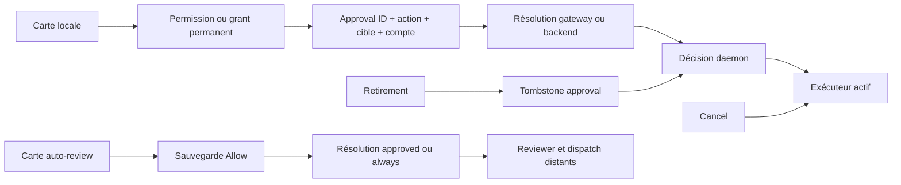
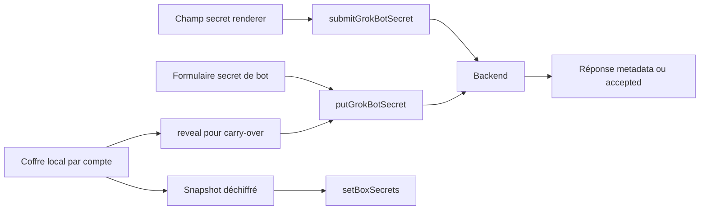

# Permissions, secrets et confiance des instructions

Cette passe approfondit le sujet 5 de l'enquête Grok Bot 0.70.2. Les chaînes nouvelles les plus utiles sont les vraies cartes UI avant résolution, le transfert des valeurs de secrets vers leurs consommateurs et la provenance du setup de template. Permission locale, auto-review et coffre sont des mécanismes séparés.

Les rapports `execution.md`, `desktop.md`, `native-peer-deep.md` et `bot-personality-detail.md` restent la base. Cette passe ajoute l'ordre des mutations de carte, le downgrade d'Always, les champs absents du tuple persisté, le retirement sans cancel, les call sites de saisie de secret et les redactions selon leur consommateur. Elle n'a exécuté ni la cible, ni un helper, ni un appel réseau ou de compte, et n'a lu aucun secret réel.

La cible est `inputs/Grok Bot.app`. Les lignes ci-dessous sont les copies LF sous `artifacts/formatted`; les originaux sont sous `artifacts/client`. Le ledger [goal-permissions-secrets.json](../evidence/goal-permissions-secrets.json) conserve les hashes des deux versions, les ancres et les hashes d'extraits. Le parent REA réutilisé est `ev_a8b822a62831e30bd01eb4c4488b36f0bd50cb8ccc41d83e2dcff4e00cf82a4d`. Aucune analyse REA globale n'a été répétée.

## Chaînes actives

Ces flèches représentent des consommateurs statiquement retracés, pas un accès modèle observé. Contexte modèle, transcript affiché, caches UI, mémoire durable et prompt de setup restent distincts.

## Quatorze constats

### PS01. La carte locale fixe l'action avant de résoudre la demande

La carte locale persiste le choix de permission ou le grant, puis éventuellement une approbation liée au requestId, à l'action et à la cible, avant `resolveLocalToolPermission`. Un échec d'Always descend à `allow-once`. Classification: observation statique.

Le call site `et → Ii` reçoit la demande affichée et les opérations du domaine permissions. Pour `global`, Always ou Never appelle d'abord `setPermission`. Un résultat différent ou un échec réduit le choix. Pour `subject`, Always nécessite un grant offert et sauvegardé; sinon il devient `allow-once`. Pour `call`, Always devient aussi `allow-once`. Quand la machine est locale, la carte écrit `recordApproval(requestId,action,target,machineId?)` avant de résoudre avec entryId, agentId et sessionId. Le plafond d'équipe doit être lu pour offrir Always dans la carte ordinaire.

Limite: la résolution distante et sa déduplication ne sont pas observées. Une approbation sauvegardée avant une résolution réseau échouée peut rester sur disque; ce call site ne prouve pas son retirement ultérieur.

Preuves: [A1: LV:906](/Users/cstpierrecharles/Desktop/grokbot-rust/artifacts/formatted/dist/renderer/assets/chunk-view-CvFjZLO2.js:906), [A2: LV:990](/Users/cstpierrecharles/Desktop/grokbot-rust/artifacts/formatted/dist/renderer/assets/chunk-view-CvFjZLO2.js:990), [A3: LV:774](/Users/cstpierrecharles/Desktop/grokbot-rust/artifacts/formatted/dist/renderer/assets/chunk-view-CvFjZLO2.js:774).

### PS02. Le tuple persisté ne contient ni machine ni génération

Le main valide un machineId fourni puis persiste id/action/target/accountScope. Le daemon compare action+cible ou une ressource attachée; le contrôle de compte diffère entre backend et box. Classification: observation statique.

`recordLocalToolApproval` vérifie l'ID, l'action, la cible et, si fourni, le machine ID du bureau. Après cet éventuel await, il ajoute l'accountScope actif. Le parser retient `id`, `action`, `target`, `resourcePath?`, `accountScope?`; il ne retient pas machineId ou generation. Le caller ne transmet pas un expectedAccountScope.

`Cbe` décrit commande exacte, stdin exact ou chemin demandé. `Pbe` compare d'abord les machineId, puis action+target. Les records et descriptions de cette chaîne n'ajoutent pas ces IDs, donc leur égalité n'est pas une preuve indépendante de binding machine. Une commande approuvée reçoit le dossier terminals comme resourcePath; un passage en arrière-plan ou la lecture d'un `.txt` directement sous ce dossier peut s'y rattacher. Le mode serveur impose le même accountScope pour une approbation locale. Le mode box ne fait pas cette comparaison dans `fQ`.

Limite: ces différences ne prouvent pas un contournement exploitable. Distribution distante des request IDs, isolation gateway et politique serveur sont absentes. La génération ne figure pas dans le tuple d'approbation.

Preuves: [A4: A:108180](/Users/cstpierrecharles/Desktop/grokbot-rust/artifacts/formatted/dist/electron-main/main-app.cjs:108180), [A5: D:79785](/Users/cstpierrecharles/Desktop/grokbot-rust/artifacts/formatted/dist/local-exec-daemon/main.cjs:79785), [A6: D:79715](/Users/cstpierrecharles/Desktop/grokbot-rust/artifacts/formatted/dist/local-exec-daemon/main.cjs:79715), [A7: D:79892](/Users/cstpierrecharles/Desktop/grokbot-rust/artifacts/formatted/dist/local-exec-daemon/main.cjs:79892).

### PS03. Retirement et cancel ont des effets différents

Le retirement inscrit une tombstone et retire l'ID de la map effective; son handler n'annule pas l'inflight. La génération de compte appartient au cycle du daemon. Classification: observation statique.

La frame backend retireApproval devient retire-approval. `P4.handle` appelle seulement onApprovalRetired. Son consommateur écrit retiredIds sous sérialisation par chemin; `pxt` soustrait ces IDs avant une prochaine décision. Les tombstones sont bornées aux IDs encore présents dans le fichier d'approbations. `clearLocalToolApprovals` efface ce fichier; les grants permanents sont un autre magasin.

Une commande passe isLocalUseBlocked avant execManager.handle. La branche cancel cherche l'inflight et émet abort. La branche retirement ne le fait pas. Pour un changement de compte, `A1` incrémente la génération, écrit le marqueur, termine les daemons identifiés et supprime credentials/connexion/découverte. Il n'ajoute pas cette génération aux approbations.

Limite: retirer une approbation ne promet pas d'arrêter une commande déjà admise. Décision, retirement et dispatch ne sont pas atomiques dans ces passages; la terminaison universelle des descendants OS n'est pas établie.

Preuves: [A8: D:79828](/Users/cstpierrecharles/Desktop/grokbot-rust/artifacts/formatted/dist/local-exec-daemon/main.cjs:79828), [A9: D:128145](/Users/cstpierrecharles/Desktop/grokbot-rust/artifacts/formatted/dist/local-exec-daemon/main.cjs:128145), [A10: D:128317](/Users/cstpierrecharles/Desktop/grokbot-rust/artifacts/formatted/dist/local-exec-daemon/main.cjs:128317), [A11: K:33612](/Users/cstpierrecharles/Desktop/grokbot-rust/artifacts/formatted/dist/electron-main/main-core.cjs:33612), [A12: K:15898](/Users/cstpierrecharles/Desktop/grokbot-rust/artifacts/formatted/dist/electron-main/main-core.cjs:15898), [A13: D:155863](/Users/cstpierrecharles/Desktop/grokbot-rust/artifacts/formatted/dist/local-exec-daemon/main.cjs:155863), [A79: main-app.cjs:126659](/Users/cstpierrecharles/Desktop/grokbot-rust/artifacts/formatted/dist/electron-main/main-app.cjs:126659).

### PS04. L'autorisation backend passe avant la politique locale

Le provider backend porte authorizedByApproval/authorizedByStanding dans `fQ` serverAuthoritative, avant le plafond local. La permission box normale est préalablement plafonnée. Classification: observation statique.

La chaîne active est `Qir → K6 → mj/P4 → fQ`. authorizedByApproval donne approval; sinon authorizedByStanding donne standing. En serverAuthoritative, approval autorise immédiatement et standing autorise immédiatement la catégorie global. Ces retours arrivent avant les refus du plafond local.

Pour la box, `znr` force authorization:none. `getLocalToolPermission` calcule le minimum entre choix et plafond avec never < ask < always. fQ refuse un plafond never, autorise global avec la permission effective always, consulte Messages puis l'approbation. Les grants de destinataire exigent compte, Messages activé et plafond compatible avec always. Le daemon accorde donc une confiance explicite au contexte backend authentifié.

Limite: le client prouve cette priorité locale, pas l'application préalable d'auto-review, des règles admin ou du plafond par le backend qui produit les booléens.

Preuves: [A14: D:79458](/Users/cstpierrecharles/Desktop/grokbot-rust/artifacts/formatted/dist/local-exec-daemon/main.cjs:79458), [A15: D:81137](/Users/cstpierrecharles/Desktop/grokbot-rust/artifacts/formatted/dist/local-exec-daemon/main.cjs:81137), [A16: D:79769](/Users/cstpierrecharles/Desktop/grokbot-rust/artifacts/formatted/dist/local-exec-daemon/main.cjs:79769), [A17: D:155835](/Users/cstpierrecharles/Desktop/grokbot-rust/artifacts/formatted/dist/local-exec-daemon/main.cjs:155835), [A18: D:156166](/Users/cstpierrecharles/Desktop/grokbot-rust/artifacts/formatted/dist/local-exec-daemon/main.cjs:156166), [A19: D:128833](/Users/cstpierrecharles/Desktop/grokbot-rust/artifacts/formatted/dist/local-exec-daemon/main.cjs:128833), [A20: D:156235](/Users/cstpierrecharles/Desktop/grokbot-rust/artifacts/formatted/dist/local-exec-daemon/main.cjs:156235), [A7: D:79892](/Users/cstpierrecharles/Desktop/grokbot-rust/artifacts/formatted/dist/local-exec-daemon/main.cjs:79892).

### PS05. Always dans auto-review sauvegarde une règle avant la résolution

La carte auto-review n'envoie always qu'après sauvegarde de la proposition Allow; un échec donne approved. Le consentement de réunion emploie une autre mémoire. Classification: observation statique.

`It → hs` sauvegarde la proposition avec `ft`, qui appelle load puis setInstructions. Si elle n'est pas sauvegardée, la résolution devient approved pour cette demande. Le résultat stale du RPC devient expired dans le cache UI indexé par agent et entrée. Une carte expirée peut encore sauvegarder sa règle sans résoudre la demande initiale.

Un remplacement ne vise une ancienne entrée Allow que si elle existe. Les appliedRules d'effet ask_first retirent la proposition ordinaire de cette vue. Pour meetingJoin, hs saute cette sauvegarde et transmet remember:meeting/all avec le consentement. Le main écrit runtime settings au backend et revient à la valeur précédente si cette écriture échoue. Les lectures miroir vérifient compte et write generation.

Limite: sauvegarde de règle et résolution sont deux mutations. Atomicité distante et priorité Allow/Block/built-in ne sont pas récupérées. Always réunion ne vaut pas permission globale.

Preuves: [A21: AV:970](/Users/cstpierrecharles/Desktop/grokbot-rust/artifacts/formatted/dist/renderer/assets/chunk-view-C686wUqG.js:970), [A22: AV:1048](/Users/cstpierrecharles/Desktop/grokbot-rust/artifacts/formatted/dist/renderer/assets/chunk-view-C686wUqG.js:1048), [A23: AS:74](/Users/cstpierrecharles/Desktop/grokbot-rust/artifacts/formatted/dist/renderer/assets/chunk-auto-review-selector-BhU4DknL.js:74), [A24: AV:1176](/Users/cstpierrecharles/Desktop/grokbot-rust/artifacts/formatted/dist/renderer/assets/chunk-view-C686wUqG.js:1176), [A25: A:107725](/Users/cstpierrecharles/Desktop/grokbot-rust/artifacts/formatted/dist/electron-main/main-app.cjs:107725).

### PS06. Réécriture et règles admin ont des consommateurs clients

Le client transmet approvedCommand, session et consentement au RPC backend; les règles admin sont lues et fournies à l'UI, mais leur évaluateur est absent. Classification: observation statique et contrat distant.

La vue de setup de template peut modifier la commande approuvée et envoie approvedCommand avec agent, entrée, request ID et session. Le main transmet cette chaîne au ResolveGrokBotAutoReviewApproval avec plateforme et consentement éventuel de réunion. Ce canal ne prouve pas que la commande modifiée repasse dans le reviewer.

`MHt` lit sandAutoReviewControls puis produit autoReviewTeamEnforced, allowInstructions et blockInstructions. Le provider UI retourne ces règles seulement si enforce est vrai. La composition active oYe installe les outils locaux d'exécution/fichiers; aucun évaluateur des textes de règles n'y est installé. Les champs et la vue sont un contrat; la décision finale est distante.

Limite: prompt et modèle reviewer, priorité admin/utilisateur/built-in, effet d'un auto-review désactivé et contrôle de commande réécrite restent inconnus. Une valeur de repli de feature flag n'est pas un réglage effectif observé.

Preuves: [A26: U:47502](/Users/cstpierrecharles/Desktop/grokbot-rust/artifacts/formatted/dist/renderer/assets/index-D6ReTfRE.js:47502), [A27: A:110906](/Users/cstpierrecharles/Desktop/grokbot-rust/artifacts/formatted/dist/electron-main/main-app.cjs:110906), [A28: A:34551](/Users/cstpierrecharles/Desktop/grokbot-rust/artifacts/formatted/dist/electron-main/main-app.cjs:34551), [A29: TP:77](/Users/cstpierrecharles/Desktop/grokbot-rust/artifacts/formatted/dist/renderer/assets/chunk-provider-team-policy-DQumFZ2C.js:77), [A30: D:128038](/Users/cstpierrecharles/Desktop/grokbot-rust/artifacts/formatted/dist/local-exec-daemon/main.cjs:128038).

### PS07. La carte secret-request remet la valeur au backend

La carte masque le champ, garde la valeur en état renderer puis appelle submitGrokBotSecret(agentId,entryId,value,sessionId). La réponse expose accepted/refusal. Classification: observation statique.

La vue we reçoit une cible box-env, bot-secret, bot-plugin-variable ou channel-credential. L'input est type:password, autoComplete off. Au submit elle capture la valeur dans g, vide l'état visible et appelle submitSecret. Une erreur restaure la valeur dans le renderer. Cette saisie n'appelle pas sendPrompt dans le passage retracé.

Le main appelle submitGrokBotSecret avec agent, entry ID, valeur et session. La cible n'est pas recopiée dans ce RPC: le backend doit la retrouver via l'entrée du transcript. Le protobuf de retour contient accepted et refusal, sans valeur.

Limite: le masque visuel ne retire pas la valeur de la mémoire renderer ni du transport. Stockage final et exclusion de la valeur du contexte modèle relèvent d'un backend absent.

Preuves: [A31: SV:525](/Users/cstpierrecharles/Desktop/grokbot-rust/artifacts/formatted/dist/renderer/assets/chunk-view-CO8DDi40.js:525), [A32: SV:369](/Users/cstpierrecharles/Desktop/grokbot-rust/artifacts/formatted/dist/renderer/assets/chunk-view-CO8DDi40.js:369), [A33: SV:112](/Users/cstpierrecharles/Desktop/grokbot-rust/artifacts/formatted/dist/renderer/assets/chunk-view-CO8DDi40.js:112), [A34: A:110748](/Users/cstpierrecharles/Desktop/grokbot-rust/artifacts/formatted/dist/electron-main/main-app.cjs:110748), [A35: P:56140](/Users/cstpierrecharles/Desktop/grokbot-rust/artifacts/formatted/dist/electron-main/proto.cjs:56140).

### PS08. Le formulaire de secret de bot va directement au service de bot

Le formulaire actif normalise nom et valeur puis putGrokBotSecret remet value au backend; liste et réponse ne contiennent que des métadonnées. Ce flow ne consomme pas le coffre local ez. Classification: observation statique.

Le parent de TeamBotDetailsDialog compose GUe(serverId) comme propriété secrets. Le dialogue passe onAdd:n.replace au formulaire. Il met le nom en majuscules, trimme description et valeur, valide et efface ses états à la fermeture. `GUe.replace → domaine secrets.put → desktop.putGrokBotSecret → GrokBotService.putGrokBotSecret` fournit name, description et value.

Le validateur UI limite le nom à 128 caractères A-Z/A-Z0-9/underscore. Il refuse notamment PATH, HOME, les noms de proxy, LD_, CURSOR_, CLOUD_AGENT_, SAND_ et CURSOR_SANDBOX. La valeur doit contenir au moins huit caractères et au plus 4096 octets UTF-8. O9e et le schéma GrokBotSecret retiennent nom, description et dates, sans value. Le transport valide une chaîne non vide, pas ces contraintes métier complètes.

Limite: la valeur existe dans l'UI et la requête backend. Le DTO sans value prouve sa non-réexposition dans ce DTO, pas son invisibilité au modèle. Aucune étape ez.upsert n'est retracée ici.

Preuves: [A36: SF:80](/Users/cstpierrecharles/Desktop/grokbot-rust/artifacts/formatted/dist/renderer/assets/chunk-team-setup-new-secret-dialog-CKCsKEFm.js:80), [A37: SF:390](/Users/cstpierrecharles/Desktop/grokbot-rust/artifacts/formatted/dist/renderer/assets/chunk-team-setup-new-secret-dialog-CKCsKEFm.js:390), [A38: SD:4881](/Users/cstpierrecharles/Desktop/grokbot-rust/artifacts/formatted/dist/renderer/assets/chunk-team-bot-details-dialog-n9GXyxFk.js:4881), [A39: SD:4626](/Users/cstpierrecharles/Desktop/grokbot-rust/artifacts/formatted/dist/renderer/assets/chunk-team-bot-details-dialog-n9GXyxFk.js:4626), [A40: U:116660](/Users/cstpierrecharles/Desktop/grokbot-rust/artifacts/formatted/dist/renderer/assets/index-D6ReTfRE.js:116660), [A41: U:116189](/Users/cstpierrecharles/Desktop/grokbot-rust/artifacts/formatted/dist/renderer/assets/index-D6ReTfRE.js:116189), [A42: R:54729](/Users/cstpierrecharles/Desktop/grokbot-rust/artifacts/formatted/dist/renderer/assets/index.eager-app-BfVhIMYf.js:54729), [A43: A:103143](/Users/cstpierrecharles/Desktop/grokbot-rust/artifacts/formatted/dist/electron-main/main-app.cjs:103143), [A44: P:53168](/Users/cstpierrecharles/Desktop/grokbot-rust/artifacts/formatted/dist/electron-main/proto.cjs:53168), [A45: SN:25](/Users/cstpierrecharles/Desktop/grokbot-rust/artifacts/formatted/dist/renderer/assets/chunk-grok-bot-secrets-vYdoKF7p.js:25), [A46: A:46577](/Users/cstpierrecharles/Desktop/grokbot-rust/artifacts/formatted/dist/electron-main/main-app.cjs:46577).

### PS09. Le coffre local déchiffre les snapshots destinés à la box

ez sépare les secrets par compte, chiffre la persistence ou utilise la mémoire; exportSnapshot renvoie les valeurs déchiffrées et Uxn les transmet à Br.setBoxSecrets. Classification: observation statique.

Ce magasin user-secrets.json est distinct des secrets par bot. upsert exige un compte actif et chiffre via safeStorage si disponible; sinon il garde les valeurs dans sessionSecrets. exportSnapshot capture accountScope, déchiffre toutes les valeurs disque et ajoute celles en mémoire. Coffre indisponible avec données persistées, ou valeur indéchiffrable, fait échouer le snapshot.

`Gpt → Uxn` sérialise les pushes. Chaque push exporte au moment de son exécution et appelle Br.setBoxSecrets({secrets}); la composition fournit cet adapter. Le scope sert à la télémétrie; l'objet transmis ici ne l'ajoute pas aux secrets. stopForQuit attend le push courant et refuse les nouveaux.

Limite: compte/génération appliqués côté gateway, persistence box et injection outils/modèles sont inconnus. Aucun appel direct de ez.upsert n'est établi dans les bundles principaux lus; cela ne prouve pas l'absence de toute ingestion locale.

Preuves: [A47: A:120334](/Users/cstpierrecharles/Desktop/grokbot-rust/artifacts/formatted/dist/electron-main/main-app.cjs:120334), [A48: A:120442](/Users/cstpierrecharles/Desktop/grokbot-rust/artifacts/formatted/dist/electron-main/main-app.cjs:120442), [A49: A:120529](/Users/cstpierrecharles/Desktop/grokbot-rust/artifacts/formatted/dist/electron-main/main-app.cjs:120529), [A50: A:126035](/Users/cstpierrecharles/Desktop/grokbot-rust/artifacts/formatted/dist/electron-main/main-app.cjs:126035).

### PS10. Le carry-over peut révéler un secret local pour le copier

carryUserSecretsToGrokBot tente la copie box puis, selon l'outcome par nom, révèle la valeur locale et appelle le put backend. Le renderer reçoit seulement un outcome par nom. Classification: observation statique.

`carryOver → carryUserSecretsToGrokBot → CXe` tente box.carryToBot(serverId,names). copied, failed et invalid-name sont terminaux. Pour les autres noms, `_Xe → Ysn` appelle userSecrets.reveal, valide la valeur trimée puis remet la valeur originale à grokBot.secrets.put, avec description vide.

La valeur traverse alors le main et le backend sans être renvoyée au renderer. Avant partage d'un bot, la liste des noms personnels combine noms locaux et box; elle ne copie pas automatiquement leurs valeurs.

Limite: restrictions de partage et consommateur backend sont absents. Un failed de la box empêche le fallback local; la politique n'est pas un retry inconditionnel.

Preuves: [A51: A:104604](/Users/cstpierrecharles/Desktop/grokbot-rust/artifacts/formatted/dist/electron-main/main-app.cjs:104604), [A52: A:108465](/Users/cstpierrecharles/Desktop/grokbot-rust/artifacts/formatted/dist/electron-main/main-app.cjs:108465), [A53: R:54757](/Users/cstpierrecharles/Desktop/grokbot-rust/artifacts/formatted/dist/renderer/assets/index.eager-app-BfVhIMYf.js:54757), [A43: A:103143](/Users/cstpierrecharles/Desktop/grokbot-rust/artifacts/formatted/dist/electron-main/main-app.cjs:103143), [A78: main-app.cjs:108420](/Users/cstpierrecharles/Desktop/grokbot-rust/artifacts/formatted/dist/electron-main/main-app.cjs:108420).

### PS11. Les redactions protègent des sorties précises

Les propositions de règles sont nettoyées avant affichage/sauvegarde; ShipIt a une sanitation de diagnostic. Le SDK redactedRead et son flag ne prouvent pas une redaction universelle du contexte modèle. Classification: observation statique, SDK séparé.

La carte auto-review importe A du selector. Cette fonction retire userinfo, query et fragment des URLs HTTP(S), masque Bearer et certains motifs de tokens et de paramètres secrets, puis réduit les espaces. Le texte nettoyé est la proposition affichée et sauvegardée. Il ne modifie pas la commande d'origine déjà soumise au reviewer.

Gft sanitise une queue de log ShipIt avec remplacement des chemins, clés privées et tokens connus; WPn la transmet à la télémétrie en pièce jointe ShipIt_stderr.sanitized.log. Le SDK contient redactedReadExecutor et RequestContextEnv.secret_redaction_enabled, mais oYe n'enregistre pas redactedRead. Les fetchs de config MCP destinés à l'exécution demandent redactSecrets:false et expandPluginVariables:true; l'édition de config demande true. Les protections dépendent du consommateur.

Limite: les regex ne reconnaissent pas tous les secrets. Aucun passage ne prouve une expurgation globale de stdout, fichiers, web, transcript ou contexte modèle.

Preuves: [A54: AS:29](/Users/cstpierrecharles/Desktop/grokbot-rust/artifacts/formatted/dist/renderer/assets/chunk-auto-review-selector-BhU4DknL.js:29), [A55: AV:1054](/Users/cstpierrecharles/Desktop/grokbot-rust/artifacts/formatted/dist/renderer/assets/chunk-view-C686wUqG.js:1054), [A56: A:123414](/Users/cstpierrecharles/Desktop/grokbot-rust/artifacts/formatted/dist/electron-main/main-app.cjs:123414), [A57: A:125363](/Users/cstpierrecharles/Desktop/grokbot-rust/artifacts/formatted/dist/electron-main/main-app.cjs:125363), [A58: D:98321](/Users/cstpierrecharles/Desktop/grokbot-rust/artifacts/formatted/dist/local-exec-daemon/main.cjs:98321), [A59: D:89742](/Users/cstpierrecharles/Desktop/grokbot-rust/artifacts/formatted/dist/local-exec-daemon/main.cjs:89742), [A30: D:128038](/Users/cstpierrecharles/Desktop/grokbot-rust/artifacts/formatted/dist/local-exec-daemon/main.cjs:128038), [A60: A:78157](/Users/cstpierrecharles/Desktop/grokbot-rust/artifacts/formatted/dist/electron-main/main-app.cjs:78157), [A61: A:78356](/Users/cstpierrecharles/Desktop/grokbot-rust/artifacts/formatted/dist/electron-main/main-app.cjs:78356).

### PS12. La confiance IPC porte sur le frame de l'application

Les handlers main contrôlent le frame trusted avant validation et exécution; cette confiance de transport ne qualifie pas les instructions de documents/plugins/pages. Classification: observation statique.

Jqt teste la politique du handler, valide les arguments puis exécute. appWindow exige le top frame de la fenêtre principale; d8e lie le document sender à processId/frameToken. Le transfert de port coordinator compare sender et senderFrame au webContents et à son mainFrame. Ce sont des contrôles d'entrée pour les commandes natives et les mutations de secrets/réglages dans les chemins examinés.

Cette confiance concerne l'émetteur Electron. Elle n'arbitre pas le texte reçu par le moteur depuis une page, une skill ou un document.

Limite: helper natif déjà étudié, non redécompilé ici. Enforcement vivant, compromission du renderer et politique de contenu du modèle ne sont pas observés.

Preuves: [A62: A:41898](/Users/cstpierrecharles/Desktop/grokbot-rust/artifacts/formatted/dist/electron-main/main-app.cjs:41898), [A63: A:107919](/Users/cstpierrecharles/Desktop/grokbot-rust/artifacts/formatted/dist/electron-main/main-app.cjs:107919), [A64: A:98240](/Users/cstpierrecharles/Desktop/grokbot-rust/artifacts/formatted/dist/electron-main/main-app.cjs:98240).

### PS13. La provenance du setup peut différer de sa prose

Le backend fournit gettingStartedTrusted; le client produit isTrustedSource et choisit automationWriteProvenance, tout en demandant par texte des routines untrusted. Classification: observation statique.

Après createGrokBotAgentFromTemplate, le client lit une recette distante et gettingStartedTrusted. Il ne conserve la getting-started skill que si cette marque est vraie. uSe envoie le modelText de setup et choisit la provenance `template_import` seulement si isConversationalSetup et isTrustedSource sont vrais; sinon `untrusted`.

Dans les deux variantes de modelText, GR demande pourtant de créer les routines désactivées et de garder leur provenance untrusted. Champ de transport et prose peuvent donc diverger pour un setup conversationnel trusted. La prose exige aussi un question widget avant d'installer un plugin cité dans une mémoire/skill/routine et interdit cette installation dans le même tour. Ces instructions arrivent au modèle via le setup; elles ne sont pas un filtre d'autorisation client.

Limite: l'arbitrage prose/provenance, la vérification serveur de gettingStartedTrusted et la résistance aux instructions contradictoires d'une recette sont inconnus.

Preuves: [A65: A:112464](/Users/cstpierrecharles/Desktop/grokbot-rust/artifacts/formatted/dist/electron-main/main-app.cjs:112464), [A66: A:87379](/Users/cstpierrecharles/Desktop/grokbot-rust/artifacts/formatted/dist/electron-main/main-app.cjs:87379), [A67: R:32982](/Users/cstpierrecharles/Desktop/grokbot-rust/artifacts/formatted/dist/renderer/assets/index.eager-app-BfVhIMYf.js:32982), [A68: U:47029](/Users/cstpierrecharles/Desktop/grokbot-rust/artifacts/formatted/dist/renderer/assets/index-D6ReTfRE.js:47029), [A69: R:10260](/Users/cstpierrecharles/Desktop/grokbot-rust/artifacts/formatted/dist/renderer/assets/index.eager-app-BfVhIMYf.js:10260), [A76: index-D6ReTfRE.js:938](/Users/cstpierrecharles/Desktop/grokbot-rust/artifacts/formatted/dist/renderer/assets/index-D6ReTfRE.js:938), [A77: index.eager-app-BfVhIMYf.js:81932](/Users/cstpierrecharles/Desktop/grokbot-rust/artifacts/formatted/dist/renderer/assets/index.eager-app-BfVhIMYf.js:81932).

### PS14. Les instructions MCP sont scopées, sans hiérarchie universelle récupérée

Les instructions MCP sont sauvegardées par server ID, scopées au compte et synchronisées; leur priorité face au système, aux plugins et au contenu document/web reste inconnue. Classification: chaîne client observée, question moteur unresolved.

setServerCustomInstructions résout un serveur connu, écrit par server ID et ne miroirise l'ancien nom que s'il est unique. Le handler pousse les réglages au backend puis synchronise la box avec mcpCustomInstructionsAccountScope. Le merge vérifie compte et write generation. Le rapport desktop établit la remise à zéro de ce scope lors de déconnexion.

Skills, instructions MCP, prose de template et documents restent des ressources distinctes. Aucun dispatcher lu ne donne un ordre global système > utilisateur > plugin > document > web. Les recherches littérales bornées aux cinq bundles principaux ne trouvent pas prompt injection, prompt_injection, prompt-injection, untrusted_text, ignore previous instructions ou instruction hierarchy. Cela n'est pas une recherche du moteur distant.

Limite: sélection des skills, contexte tools/documents/web, conflits d'instructions et garanties contre l'exfiltration restent unresolved côté moteur.

Preuves: [A70: A:76493](/Users/cstpierrecharles/Desktop/grokbot-rust/artifacts/formatted/dist/electron-main/main-app.cjs:76493), [A71: A:113440](/Users/cstpierrecharles/Desktop/grokbot-rust/artifacts/formatted/dist/electron-main/main-app.cjs:113440), [A72: A:98533](/Users/cstpierrecharles/Desktop/grokbot-rust/artifacts/formatted/dist/electron-main/main-app.cjs:98533), [A73: A:81239](/Users/cstpierrecharles/Desktop/grokbot-rust/artifacts/formatted/dist/electron-main/main-app.cjs:81239), [A74: D:79946](/Users/cstpierrecharles/Desktop/grokbot-rust/artifacts/formatted/dist/local-exec-daemon/main.cjs:79946), [A75: C:39010](/Users/cstpierrecharles/Desktop/grokbot-rust/artifacts/formatted/dist/node-agent-coordinator/main.cjs:39010).

## Schémas et déclarations séparés

| Élément | Champs ou règle récupérée | Frontière |
|---|---|---|
| Approval persistée | id, action, target, resourcePath?, accountScope? | MachineId/génération absents du tuple |
| Autorisation backend | authorizedByApproval, authorizedByStanding | Évaluation serveur absente |
| Auto-review utilisateur | isEnabled, Allow[], Block[]; 20 entrées/1000 caractères chacune | Pas l'ordre d'évaluation |
| Auto-review équipe | enforceEnabled, Allow[], Block[] | Pas un enforcement moteur observé |
| Résolution reviewer | agentId, requestId, resolution, platform, approvedCommand?, sessionId?, meetingJoin? | Pas un nouveau review prouvé après réécriture |
| Secret de bot public | nom, description, dates | Pas le stockage ou l'accès modèle à value |
| Secret soumis | agentId, entryId, value, sessionId | Backend retrouve la cible de l'entrée |
| storeSecret | box-env ou channel-credential, value, agentId | Contrat partagé, pas un appel ez.upsert établi |
| redactedRead/secret_redaction_enabled | Ressource et champ du SDK | Pas un outil local actif ou une protection globale |
| 1Password | Provisioning token vers backend et consentement, déjà retracés | Login → secret → remplissage → modèle reste absent |

## Inconnues et propositions de reconstruction

Restent inconnus le moteur reviewer, le contrôle d'une commande réécrite, les règles de contexte modèle, le cycle secrets backend/box et la vérification de confiance d'un template. Les recherches négatives sont bornées dans le ledger. La promesse UI 1Password de non-visibilité des valeurs n'est pas requalifiée en garantie; execution.md avait déjà établi la frontière backend.

Propositions, pas caractéristiques prouvées du produit: lier l'approbation à compte, machine, génération, action et hash d'arguments; rendre explicite l'extension aux artifacts terminals; décider si retirement doit aussi annuler; faire réévaluer les commandes réécrites; séparer autorisation backend et policy locale; fournir des références opaques de secrets aux outils. Il faut vérifier l'absence de valeurs dans le contexte modèle et les sorties, et définir une priorité des instructions externes avec des tests de conflits document/plugin/web. La confiance IPC ne suffit pas à cette dernière règle.

## Checklist finale

| Question | Statut | Frontière restante |
|---|---|---|
| Binding commande/fichier/approval ID | answered-client-side | Extension terminals prouvée; IDs distants non observés |
| Binding compte, machine, génération | partially_answered | Validation machine à l'écriture; compte backend/box différent; génération hors tuple |
| Retirement, cancel, fin de compte | answered-client-side | Retrait ne promet pas arrêt d'une commande admise |
| Persistent allow et carte auto-review | answered-client-side | Sauvegarde avant résolution et downgrade prouvés; atomicité distante inconnue |
| Priorité review/admin/user/built-in et réécriture | partially_answered | Champs/UI/RPC actifs; évaluateur absent |
| UI → backend, coffre → box, carry-over | answered-client-side | Persistence et usage distants inconnus |
| Redaction et invisibilité modèle | partially_answered | Sorties ciblées; pas de garantie universelle |
| 1Password lecture/remplissage/visibilité modèle | unresolved | Backend/box au-delà du client, déjà signalés |
| Confiance document/plugin/web et conflits | partially_answered | IPC et setup retracés; hiérarchie moteur unresolved |
