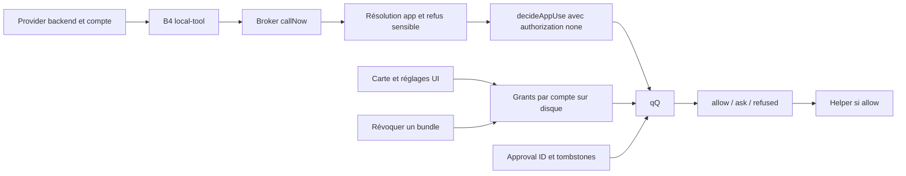

# Consentement des apps locales dans Grok Bot 0.71.2

Le nouveau circuit local-tool possède une décision par app reliée au daemon. Les grants permanents portent sur le compte et le bundleId. Leur suppression est relue lors d'une nouvelle décision; elle n'est pas raccordée à l'annulation d'un appel déjà admis ou à la fermeture du helper.

Cette passe complète [la découverte .71](release-0712-discovery.md) et reste distincte de [l'analyse .70](goal-permissions-secrets.md). Le parent suit le transport broker et une autre passe suit le helper natif. Ici, aucune app, helper, RPC, compte, profil ou secret vivant n'est utilisé. La cible n'est ni installée ni exécutée. Aucun ancien rapport, index ou source n'est modifié.

Les originaux immuables sont sous `artifacts/releases/0.71.2/client`; les copies LF préexistantes sont sous `formatted`. La carte lazy est citée sur sa ligne originale minifiée, sans nouvelle copie. Le [ledger](../evidence/local-cua-consent-0712.json) conserve version, hashes, lignes LF et ancres, recoupés avec les inventaires versionnés. Références REA .71 réutilisées: `ev_87e734ee1e33c5a658dfe8d3861d7e99a0eeba507bdcadc54ad521305bca7bf8` et `ev_899fd0c224155306982f15219634bb0ad958dd57df86d099317ad9ea02d02bf4`. Aucun nouveau graphe global n'est produit.

## Chaîne active



Ces flèches représentent des appels reliés statiquement, sans exécution observée. Le retour ask au backend est distinct de l'attente des permissions macOS à l'intérieur du broker. La suppression d'un grant n'ajoute pas de flèche vers cancel ou stop.

## Huit constats

### C71-01. Le consentement app rejoint une politique réellement installée

Le provider backend compose B4 avec computerUse et decideLocalUse; chaque appel app rejoint qQ avec le compte du provider et authorization:none. Classification: observation statique.

La composition `se = new sN(...)` fournit le broker à chaque B4 du provider Gj. decideLocalUse capture le compte et serverAuthoritative de ce provider. handleLocalTool crée un signal d'annulation et transmet `decideAppUse(call.approvalId,bundleId)`. Ce callback décrit `{action:"use-app",target:bundleId,recipient:bundleId}` et force authorization:none. `ie → V → qQ` ajoute permission effective, plafond, chemins des approvals/retraits/grants et accountScope.

Le verdict ask devient `{status:"ask",app:{bundleId,appName}}`, renvoyé comme résultat au backend. Le broker ne garde pas à cet endroit une promesse attendant le clic humain. La fabrication de carte et le relancement backend sont une frontière séparée.

Limite: serverAuthoritative n'est pas, à lui seul, un allow pour ce call: authorization est remis à none. L'évaluation et le relancement backend ne sont pas livrés.

Preuves: [A1: D:157615](/Users/cstpierrecharles/Desktop/grokbot-rust/artifacts/releases/0.71.2/formatted/dist/local-exec-daemon/main.cjs:157615), [A2: D:157668](/Users/cstpierrecharles/Desktop/grokbot-rust/artifacts/releases/0.71.2/formatted/dist/local-exec-daemon/main.cjs:157668), [A3: D:128263](/Users/cstpierrecharles/Desktop/grokbot-rust/artifacts/releases/0.71.2/formatted/dist/local-exec-daemon/main.cjs:128263), [A4: D:128566](/Users/cstpierrecharles/Desktop/grokbot-rust/artifacts/releases/0.71.2/formatted/dist/local-exec-daemon/main.cjs:128566), [A5: D:128712](/Users/cstpierrecharles/Desktop/grokbot-rust/artifacts/releases/0.71.2/formatted/dist/local-exec-daemon/main.cjs:128712).

### C71-02. L'app sensible est refusée avant l'évaluation du grant

Le broker résout une app par pid/target_id et refuse les catégories sensibles avant decideAppUse. Trois outils free ne demandent pas ce consentement app. Classification: observation statique.

Les 14 computer_* sont répartis en app, free et resolve. computer_wait, computer_check_permissions et computer_apps sont free. Une action app exige scope:app, un PID entier sûr positif et target_id non vide, retrouvés dans le cache ou dans runningApps. La clé de cache `[pid,targetId]` conserve les métadonnées retournées par le helper, pas une autorisation.

computer_resolve_app exige exactement un bundle_id, app_name ou pid et refuse app_path. Un bundle pas encore lancé peut être identifié pour demander son autorisation avant ouverture. Les catégories sensibles comprennent terminaux, outils de scripts/Automator/Shortcuts, gestionnaires Apple de mots de passe, Cursor, System Settings, Grok Bot et les préfixes de son helper. Les noms connus bloquent tôt resolve; Mee contrôle encore le bundle avant le callback de consentement. Un grant ne supprime pas ce refus.

Limite: la table JavaScript ne classe pas universellement toutes les apps et ne prouve pas l'identité signée du processus. Authenticité du handle et protections natives sont dans l'autre périmètre. Les outils free ne donnent pas le droit de piloter une app.

Preuves: [A6: D:82831](/Users/cstpierrecharles/Desktop/grokbot-rust/artifacts/releases/0.71.2/formatted/dist/local-exec-daemon/main.cjs:82831), [A7: D:82929](/Users/cstpierrecharles/Desktop/grokbot-rust/artifacts/releases/0.71.2/formatted/dist/local-exec-daemon/main.cjs:82929), [A8: D:82976](/Users/cstpierrecharles/Desktop/grokbot-rust/artifacts/releases/0.71.2/formatted/dist/local-exec-daemon/main.cjs:82976), [A9: D:83029](/Users/cstpierrecharles/Desktop/grokbot-rust/artifacts/releases/0.71.2/formatted/dist/local-exec-daemon/main.cjs:83029).

### C71-03. Always global ne signifie pas toutes les apps

use-app est une catégorie subject; le raccourci permission:always de qQ ne concerne que global. Les standing grants ont des conditions distinctes. Classification: observation statique.

Qbt exige absence d'approvalId, accountScope présent, plafond absent ou always, et permission effective différente de never. Le réglage Messages n'est requis que pour les deux actions Messages. Qbt vérifie d'abord scope:action puis scope:subject avec recipient=bundleId. Avec un approvalId présent, le chemin standing est sauté; l'approbation liée à action/cible est consultée après les tombstones.

La permission effective est le minimum du choix local et du plafond. L'autorisation backend approval/standing est testée en tête de qQ, mais decideAppUse a fourni none: ce raccourci n'autorise donc pas ce call app. Le bloc de refus never/plafond never appartient à la branche non serverAuthoritative. La branche serverAuthoritative conserve ensuite la vérification de compte sur une approbation persistée. Cet ordre n'établit pas un plafond local identique entre les modes.

Limite: aucun grant ou approval effectif n'est observé. Distribution et validité de l'approvalId viennent des services amont. Aucun contournement serveur ou scénario exploitable n'est démontré.

Preuves: [A10: D:79640](/Users/cstpierrecharles/Desktop/grokbot-rust/artifacts/releases/0.71.2/formatted/dist/local-exec-daemon/main.cjs:79640), [A11: D:80075](/Users/cstpierrecharles/Desktop/grokbot-rust/artifacts/releases/0.71.2/formatted/dist/local-exec-daemon/main.cjs:80075), [A12: D:81406](/Users/cstpierrecharles/Desktop/grokbot-rust/artifacts/releases/0.71.2/formatted/dist/local-exec-daemon/main.cjs:81406), [A13: D:128290](/Users/cstpierrecharles/Desktop/grokbot-rust/artifacts/releases/0.71.2/formatted/dist/local-exec-daemon/main.cjs:128290).

### C71-04. La clé persistée porte sur compte, action et bundle

Le fichier local-tool-standing-grants.v1.json contient un JSON version 1. La clé subject est `[accountScope,"subject",action,recipient]`; nom et date ne font pas partie de cette clé. Classification: observation statique.

Le parser exige compte non vide et grantedAtMs fini positif ou nul. Recipient et nom optionnel sont des lignes trimées, non vides, au plus 320 unités de chaîne, sans CR/LF. Il ne convertit pas le bundleId en minuscules; le refus des apps sensibles normalise sa casse séparément.

Un grant scope:action a la clé `[accountScope,"action",action]`. Ajouter une clé existante conserve la première entrée. Le JSON ne contient ni PID, target_id, conversation, machine ID, génération, empreinte de binaire ou expiration. Le store main sérialise les mutations, relit pour chaque mutation et écrit par le durable file et ses copies bornées. Le daemon relit le JSON avant chaque décision standing; une erreur read/parse donne un ensemble vide.

Limite: ces champs absents n'excluent pas d'autres garanties natives ou serveur. Mode/ACL effectif et fichier utilisateur réel n'ont pas été consultés. Aucune expiration n'est consommée dans ce format.

Preuves: [A14: K:15618](/Users/cstpierrecharles/Desktop/grokbot-rust/artifacts/releases/0.71.2/formatted/dist/electron-main/main-core.cjs:15618), [A15: K:19350](/Users/cstpierrecharles/Desktop/grokbot-rust/artifacts/releases/0.71.2/formatted/dist/electron-main/main-core.cjs:19350), [A16: A:107663](/Users/cstpierrecharles/Desktop/grokbot-rust/artifacts/releases/0.71.2/formatted/dist/electron-main/main-app.cjs:107663), [A17: A:107733](/Users/cstpierrecharles/Desktop/grokbot-rust/artifacts/releases/0.71.2/formatted/dist/electron-main/main-app.cjs:107733), [A18: D:79960](/Users/cstpierrecharles/Desktop/grokbot-rust/artifacts/releases/0.71.2/formatted/dist/local-exec-daemon/main.cjs:79960), [A19: D:80078](/Users/cstpierrecharles/Desktop/grokbot-rust/artifacts/releases/0.71.2/formatted/dist/local-exec-daemon/main.cjs:80078).

### C71-05. Le clic permanent écrit un sujet use-app

La carte transmet recipientName pour use-app. Le main vérifie la machine si elle est fournie, puis écrit le grant du compte actif et renvoie stored:true. Classification: observation statique.

Le lazy chunk-view-Cn7TqCtd exige une standingGrant offerte et recordApprovalLocally pour Always sur subject. Il appelle recordStandingGrant avec action, recipient et machineId éventuel; recipientName est ajouté pour use-app. Une erreur ou stored:false réduit le choix à allow-once.

Le handler rejette une machine fournie différente du bureau et une action non classée subject. Il parse recipient/nom, exige un compte actif, puis écrit scope:subject/action/recipient/accountScope/grantedAtMs. La machine est vérifiée à l'entrée mais ne rejoint pas la clé persistée. Le nom affiché ne remplace pas le bundleId.

Limite: le call site ne reconstitue pas le service qui crée la carte depuis un résultat ask. Aucun consentement réel n'est obtenu pendant cette enquête.

Preuves: [A20: V:2](/Users/cstpierrecharles/Desktop/grokbot-rust/artifacts/releases/0.71.2/client/dist/renderer/assets/chunk-view-Cn7TqCtd.js:2), [A21: R:55294](/Users/cstpierrecharles/Desktop/grokbot-rust/artifacts/releases/0.71.2/formatted/dist/renderer/assets/index.eager-app-BIotefBk.js:55294), [A22: A:111509](/Users/cstpierrecharles/Desktop/grokbot-rust/artifacts/releases/0.71.2/formatted/dist/electron-main/main-app.cjs:111509).

### C71-06. Révoquer retire un sujet sans fermer la session

La liste AllowedApps expose seulement subject/use-app pour le compte actif. La révocation supprime exactement cette clé et renvoie la liste restante, sans cancel ou stop de helper. Classification: observation statique.

La ressource renderer allowedApps applique la réponse de revokeAllowedApp via write; le provider UI exporte refresh et revoke. Le main exige la gate computer use, capture le compte actif, parse le bundleId et appelle standingGrants.revoke sur scope:subject/action:use-app/recipient. Un bundle invalide ne supprime rien. Le store enlève la clé et réécrit le JSON. Aucun callback de cette chaîne ne demande au broker de fermer ses sessions ou d'annuler des calls.

La liste exclut scope:action. Le handler générique setLocalToolActionGrant accepte les actions classées subject, dont use-app, et qQ peut consulter ce grant avant celui du bundle. Son existence n'est pas supposée. Retirer une entrée ne supprime donc pas toute autorisation indépendante possible: un grant d'action et une approval ponctuelle sont d'autres records.

Limite: c'est une mutation locale, pas une révocation distribuée prouvée. Aucun push explicite de suppression, arrêt d'effet ou purge d'approval ID n'est fourni par ces handlers.

Preuves: [A23: A:110856](/Users/cstpierrecharles/Desktop/grokbot-rust/artifacts/releases/0.71.2/formatted/dist/electron-main/main-app.cjs:110856), [A24: R:55263](/Users/cstpierrecharles/Desktop/grokbot-rust/artifacts/releases/0.71.2/formatted/dist/renderer/assets/index.eager-app-BIotefBk.js:55263), [A25: U:49](/Users/cstpierrecharles/Desktop/grokbot-rust/artifacts/releases/0.71.2/formatted/dist/renderer/assets/chunk-provider-computer-use-_8Rdmtlu.js:49), [A26: K:15688](/Users/cstpierrecharles/Desktop/grokbot-rust/artifacts/releases/0.71.2/formatted/dist/electron-main/main-core.cjs:15688), [A27: A:111557](/Users/cstpierrecharles/Desktop/grokbot-rust/artifacts/releases/0.71.2/formatted/dist/electron-main/main-app.cjs:111557), [A28: A:110565](/Users/cstpierrecharles/Desktop/grokbot-rust/artifacts/releases/0.71.2/formatted/dist/electron-main/main-app.cjs:110565).

### C71-07. Le prochain appel relit le grant; un appel admis ne le relit pas toujours

callNow rappelle qAe pour chaque appel, même avec un handle en cache. Après admission, le retry pour permission macOS ne refait pas decideAppUse; la révocation UI ne touche pas son signal. Classification: inférence statique.

La file est sérialisée par conversation. Un call en attente atteint callNow après son tour de file; qAe/Mee demande alors un nouveau verdict pour le bundle. Le chemin standing lit le fichier à ce moment. Une révocation sauvegardée peut donc affecter le prochain call dans une session helper conservée.

Après qAe, runUntilGranted appelle le helper. Si celui-ci répond permission_required, le broker attend la permission macOS puis refait le même tools/call. Il recontrôle helper et signal, mais pas qAe/grant. Une suppression entre l'admission et le retry n'est donc pas une condition d'arrêt dans cette branche. Une action déjà envoyée ne reçoit pas non plus un cancel provenant du handler de révocation. Cancel et fermeture existent, mais ne sont pas raccordés à cette suppression.

Limite: aucune course n'est reproduite. D'autres contrôles natifs/serveur restent possibles. La révocation ne promet ni rollback ni arrêt instantané de toutes les interactions.

Preuves: [A29: D:128547](/Users/cstpierrecharles/Desktop/grokbot-rust/artifacts/releases/0.71.2/formatted/dist/local-exec-daemon/main.cjs:128547), [A30: D:128621](/Users/cstpierrecharles/Desktop/grokbot-rust/artifacts/releases/0.71.2/formatted/dist/local-exec-daemon/main.cjs:128621), [A31: D:128743](/Users/cstpierrecharles/Desktop/grokbot-rust/artifacts/releases/0.71.2/formatted/dist/local-exec-daemon/main.cjs:128743), [A32: D:128803](/Users/cstpierrecharles/Desktop/grokbot-rust/artifacts/releases/0.71.2/formatted/dist/local-exec-daemon/main.cjs:128803), [A33: A:110871](/Users/cstpierrecharles/Desktop/grokbot-rust/artifacts/releases/0.71.2/formatted/dist/electron-main/main-app.cjs:110871), [A34: D:79960](/Users/cstpierrecharles/Desktop/grokbot-rust/artifacts/releases/0.71.2/formatted/dist/local-exec-daemon/main.cjs:79960).

### C71-08. L'activation .71 ne change pas rétroactivement .70

La preuve concerne la branche local-tool/computerUse de 0.71.2. Les quatre handlers SDK observés dans oYe 0.70.2 restent une description correcte de cet ancien constructeur. Classification: observation statique.

L'ancien oYe enregistre shell foreground, shell background, read et ls. Les autres descripteurs SDK ne les activaient pas. En .71, B4.handle reçoit local-tool, appelle handleLocalTool et reçoit computerUse/decideLocalUse des providers backend. C'est un autre point d'entrée.

Le hello .71 annonce localToolAppConsent et localToolGrantSeen quand il expose des local tools. Ces drapeaux indiquent une capacité de protocole; ils ne constituent pas un grant ni la preuve qu'un serveur applique la révocation.

Limite: cette passe ne date pas l'introduction exacte de chaque fonction UI et n'observe pas la production. Transport backend et implémentation native restent des périmètres séparés.

Preuves: [A35: D70:128042](/Users/cstpierrecharles/Desktop/grokbot-rust/artifacts/formatted/dist/local-exec-daemon/main.cjs:128042), [A36: D:128137](/Users/cstpierrecharles/Desktop/grokbot-rust/artifacts/releases/0.71.2/formatted/dist/local-exec-daemon/main.cjs:128137), [A37: D:157668](/Users/cstpierrecharles/Desktop/grokbot-rust/artifacts/releases/0.71.2/formatted/dist/local-exec-daemon/main.cjs:157668), [A38: D:156680](/Users/cstpierrecharles/Desktop/grokbot-rust/artifacts/releases/0.71.2/formatted/dist/local-exec-daemon/main.cjs:156680).

## Effet précis d'une révocation

| Situation | Conséquence du code | Limite |
|---|---|---|
| Nouveau call après suppression du subject | Nouvelle décision et lecture disque | Un grant action ou une approval distincte peuvent rester |
| Call encore en file | qAe vient après la file | Course avec le commit non reproduite |
| Call admis en attente de permission macOS | Retry sans relecture du grant dans cette branche | Contrôles natifs/serveur inconnus |
| Call déjà envoyé au helper | Aucun cancel issu de revoke | Effet en cours ou terminé possible |
| Session helper conservée | Le prochain call refait la policy | Le cache de handle n'est pas un cache de consentement |
| AllowedApps vide | Pas de subject/use-app listé pour ce compte | Ne prouve pas absence d'action grant ou d'approval |

## Vérificateur hors ligne rejouable

Le petit vérificateur stdlib existant fonctionne avec les chemins explicites de ce ledger .71, sans utiliser l'ancien manifeste .70. Il recalcule hashes des originaux, copies et extraits, puis vérifie les ancres. Depuis la racine du dépôt:

```sh
PYTHONDONTWRITEBYTECODE=1 python3 tools/evidence_ledger.py evidence/local-cua-consent-0712.json
```

Cette commande ne lance aucun JavaScript cible, helper ou réseau et ne consulte aucun fichier de compte. Elle vérifie les octets cités, pas l'enforcement vivant. Le ledger conserve aussi l'identité ASAR et les pinning manifests relus à sa création.

## Checklist finale

| Question | Statut | Limite |
|---|---|---|
| Chaîne active app → verdict → helper | answered-client-side | Composition .71, sans exécution cible |
| Clé/persistence/lecture des grants | answered-client-side | Format et consommateurs, pas de fichier utilisateur |
| Apps sensibles et scope par app | partially_answered | Gardes JS; identité native séparée |
| Révocation et prochains calls | answered-client-side | Suppression exacte; autres autorisations séparées |
| Calls admis et sessions | partially_answered | Aucun cancel/stop raccordé; retry OS sans relecture ici |
| Propagation backend et révocation distribuée | unresolved | Aucun handler backend ni trace d'exécution |
| Frontière .70/.71 | answered-client-side | Nouveau chemin .71, aucune rétroattribution |
