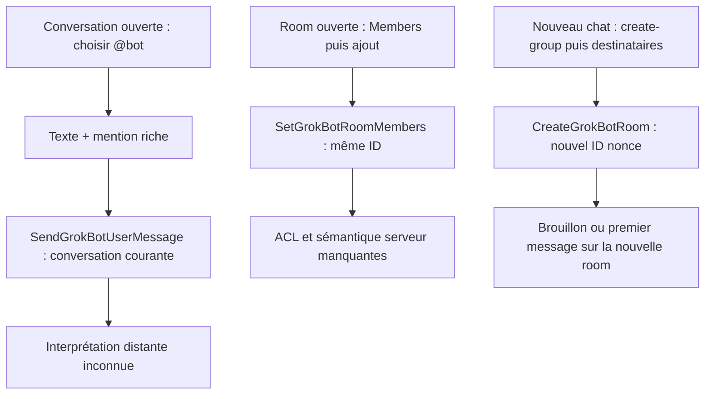

# Ajouter des bots à une conversation : mentions, membres et nouveaux groupes

Le `@` et le bouton d'ajout de membre suivent deux chemins distincts. Dans une room existante, l'ajout explicite conserve son identifiant et modifie ses membres. Le parcours « nouveau groupe » crée une room puis y envoie le brouillon. Aucun appel de conversion d'une conversation individuelle n'est présent dans la chaîne de mention inspectée.

Cette passe apporte les consommateurs de membership qui manquaient à [l'enquête interbot](interbot-client-paths.md) et aux [contrats mobile/interbot](interbot-mobile-protocol.md). Elle compare les copies livrées 0.70.2 et 0.71.2; elle ne réattribue pas une documentation actuelle à une ancienne release. Parent REA réutilisé : `ev_a8b822a62831e30bd01eb4c4488b36f0bd50cb8ccc41d83e2dcff4e00cf82a4d`. Aucune exécution cible, connexion, lecture de profil ou requête réseau. Les chaînes ci-dessous sont statiques.

## M1. Dans une conversation déjà ouverte, @ adresse le message; il ne sélectionne pas des nouveaux membres

Dans les deux releases, le fournisseur de suggestions prend les `memberIds` résolus si `isCurrentGroup` est vrai. Hors groupe, il peut proposer d'autres bots et des rooms contenant le bot courant, selon le filtre des bots d'équipe. Le choix insère un nœud mention avec ID et label. Le composeur envoie le texte et le document riche à l'agent/session de la conversation courante; le performer consomme ces champs dans `SendGrokBotUserMessage`.

La comparaison nouvelle porte sur le lien avec les mutations explicites ci-dessous : cette chaîne d'insertion/envoi n'appelle ni `setGroupMembers` ni `createGroup`. Un bot extérieur proposé dans un chat individuel n'est donc pas démontré comme nouveau membre par le clic sur `@`. Dans une room, le menu n'offre que les bots déjà membres et résolus dans le roster.

Sources : [A1 70:index-D6ReTfRE.js:118068](../artifacts/formatted/dist/renderer/assets/index-D6ReTfRE.js:118068), [A2 71:index-DLY0TQjI.js:123200](../artifacts/releases/0.71.2/formatted/dist/renderer/assets/index-DLY0TQjI.js:123200), [A3 70:chunk-prompt-editor-DisVTqqh.js:2862](../artifacts/formatted/dist/renderer/assets/chunk-prompt-editor-DisVTqqh.js:2862), [A6 70:index-D6ReTfRE.js:119009](../artifacts/formatted/dist/renderer/assets/index-D6ReTfRE.js:119009), [A4 71:index-DLY0TQjI.js:124140](../artifacts/releases/0.71.2/formatted/dist/renderer/assets/index-DLY0TQjI.js:124140), [A5 71:main-app.cjs:113145](../artifacts/releases/0.71.2/formatted/dist/electron-main/main-app.cjs:113145).

**Limite.** Le serveur peut interpréter la mention et le bot peut agir ensuite. Ce traitement et un éventuel effet serveur sur le membership restent inconnus. Le constat borne ce que cette chaîne client produit.

## M2. Les contrôles de membres sont attachés à l'identité ROOM

Le normaliseur `.71` transforme `kind=ROOM` en `isGroup` et copie ses `memberAgentIds`. Le panneau d'informations utilise ce flag et expose la section `members`. Une room dont `viewerIsOwner` vaut explicitement false obtient une vue `membersOnly`; le même composant de membres est aussi monté dans les autres présentations de groupe. Le montage `.70` correspondant est présent.

Pour l'utilisateur : ouvrir les détails de la conversation puis « Members » est le chemin vers le vrai membership d'une room. Un chat individuel `isGroup=false` n'obtient pas ce panneau dans ces branches. Une room peut contenir un seul bot : il faut lire son type, pas seulement compter les noms visibles.

Sources : [A7 71:main-app.cjs:101208](../artifacts/releases/0.71.2/formatted/dist/electron-main/main-app.cjs:101208), [A8 71:index-DLY0TQjI.js:46593](../artifacts/releases/0.71.2/formatted/dist/renderer/assets/index-DLY0TQjI.js:46593), [A9 71:index-DLY0TQjI.js:47163](../artifacts/releases/0.71.2/formatted/dist/renderer/assets/index-DLY0TQjI.js:47163), [A10 71:index.eager-app-BIotefBk.js:32254](../artifacts/releases/0.71.2/formatted/dist/renderer/assets/index.eager-app-BIotefBk.js:32254), [A11 70:index-D6ReTfRE.js:44710](../artifacts/formatted/dist/renderer/assets/index-D6ReTfRE.js:44710).

**Limite.** Les libellés et branches sont livrés; leur disponibilité effective dépend des données et gates du compte, non consultées ici.

## M3. Ajouter à une room existante conserve son ID; le payload dépend du propriétaire

Le composant `L2` appelle `roster.setGroupMembers` avec `id: n.id`, sans créer une autre conversation. Les conditions exactes sont :

| Action UI | Condition et payload client |
|---|---|
| Ajouter un bot, propriétaire | `viewerIsOwner !== false`; liste complète `[..., memberIds, nouveauId]` |
| Ajouter un bot, autre participant | groupe contenant des personnes et gate `grok_bot_group_chats`; singleton `[nouveauId]` |
| Retirer un bot | bouton affiché au propriétaire; au moins deux bots avant retrait; relecture du roster avant filtrage |

L'ajout exige aussi une place disponible et un candidat éligible. Le retrait conserve au moins un bot côté UI. `.70` contient déjà cette distinction liste complète/singleton. Le backend adapter `.71` appelle `SetGrokBotRoomMembers` sur le même `agentId` puis vérifie l'ID de réponse.

Sources : [A12 71:index-DLY0TQjI.js:41223](../artifacts/releases/0.71.2/formatted/dist/renderer/assets/index-DLY0TQjI.js:41223), [A13 71:index-DLY0TQjI.js:41346](../artifacts/releases/0.71.2/formatted/dist/renderer/assets/index-DLY0TQjI.js:41346), [A14 71:index-DLY0TQjI.js:41288](../artifacts/releases/0.71.2/formatted/dist/renderer/assets/index-DLY0TQjI.js:41288), [A15 70:index-D6ReTfRE.js:38927](../artifacts/formatted/dist/renderer/assets/index-D6ReTfRE.js:38927), [A34 71:main-app.cjs:101378](../artifacts/releases/0.71.2/formatted/dist/electron-main/main-app.cjs:101378).

**Limite.** Pour un non-propriétaire, le client émet un singleton; on ne peut pas en déduire que le serveur remplace toute la liste. La règle serveur d'ajout/retrait manque. Le test UI traite un champ `viewerIsOwner` absent comme ownerlike; ce repli n'est pas une observation de droits effectifs.

## M4. Les candidats et plafonds dépendent de la présence d'humains

Le sélecteur exclut les groupes, l'ID de la room et les bots déjà membres. Il applique ensuite :

| Room existante | Candidats additionnels | Plafond bots UI |
|---|---|---:|
| Avec personnes | teamId de room requis; bot Temporal, visibilité `team`, teamId absent ou identique | 3 |
| Sans personnes, avec teamId | bot Temporal | 6 |
| Sans personnes, sans teamId | bot dont `viewerIsOwner` n'est pas false | 6 |

Les constantes et conditions sont identiques dans les passages `.70` et `.71` inspectés. Le plafond humain distinct vaut 20; le sélecteur de nouvelles personnes exclut soi et les personnes déjà présentes.

Sources : [A16 71:index.eager-app-BIotefBk.js:8031](../artifacts/releases/0.71.2/formatted/dist/renderer/assets/index.eager-app-BIotefBk.js:8031), [A17 71:index.eager-app-BIotefBk.js:8077](../artifacts/releases/0.71.2/formatted/dist/renderer/assets/index.eager-app-BIotefBk.js:8077), [A18 71:index.eager-app-BIotefBk.js:8118](../artifacts/releases/0.71.2/formatted/dist/renderer/assets/index.eager-app-BIotefBk.js:8118), [A19 70:index.eager-app-BfVhIMYf.js:7675](../artifacts/formatted/dist/renderer/assets/index.eager-app-BfVhIMYf.js:7675), [A20 70:index.eager-app-BfVhIMYf.js:7759](../artifacts/formatted/dist/renderer/assets/index.eager-app-BfVhIMYf.js:7759).

**Limite.** Il s'agit des plafonds et filtres du client livré. Le serveur peut appliquer d'autres limites; aucune valeur effective de compte n'a été observée.

## M5. Le nouveau groupe empêche certaines combinaisons de bots personnels et partagés

Le sélecteur `.71` rend les candidats incompatibles avec `isUnseatable=true`; les prédicats d'ajout et de validation refusent ces lignes. En présence d'au moins un destinataire humain, seuls les bots Temporal publiés (`visibility=team`) compatibles avec le teamId sont sélectionnables. Le nombre de bots est alors borné à 3.

Sans humain sélectionné, le garde est bidirectionnel : sélectionner un bot non possédé compatible rend les bots non-Temporal inéligibles; sélectionner un destinataire nouveau ou un bot non-Temporal rend les bots non possédés inéligibles. Les bots non possédés doivent aussi être compatibles avec le teamId. Le garde existe déjà en `.70`.

Sources : [A21 71:index-DLY0TQjI.js:98160](../artifacts/releases/0.71.2/formatted/dist/renderer/assets/index-DLY0TQjI.js:98160), [A22 71:index-DLY0TQjI.js:98273](../artifacts/releases/0.71.2/formatted/dist/renderer/assets/index-DLY0TQjI.js:98273), [A23 71:index.eager-app-BIotefBk.js:28897](../artifacts/releases/0.71.2/formatted/dist/renderer/assets/index.eager-app-BIotefBk.js:28897), [A24 70:index-D6ReTfRE.js:93363](../artifacts/formatted/dist/renderer/assets/index-D6ReTfRE.js:93363), [A25 71:chunk-new-chat-bar-ChVWSK_D.js:970](../artifacts/releases/0.71.2/formatted/dist/renderer/assets/chunk-new-chat-bar-ChVWSK_D.js:970).

**Limite.** Le code compare `harness`, `viewerIsOwner`, `visibility` et `teamId`. Il ne teste pas directement « your-own-computer » ou un `machineId` dans ce garde. Il confirme une restriction concrète de combinaison, sans prouver une équivalence générale entre ce libellé produit et chaque harness.

## M6. « Nouveau groupe » sélectionne des destinataires puis crée une conversation

Dans les deux chunks new-chat-bar, sélectionner la ligne `create-group` active le mode groupe et garde le focus dans le sélecteur. Plusieurs destinataires sont ajoutés comme chips avant validation. Avec les group chats activés, un destinataire bot unique ouvre son chat; plusieurs destinataires produisent un lancement de type `group`. Le helper exige au moins un destinataire non humain. Avec la fonctionnalité désactivée, le repli peut créer un groupe à un seul bot.

La chaîne `.71` est : `create-group` → mode groupe → `Xp` → `stageNewChatGroup` → `wze` → `roster.createGroup`. Le helper sépare IDs de bots et userIds humains; un destinataire de type « nouveau » entraîne d'abord la création d'un bot. Après création, il sélectionne l'ID retourné et récupère le brouillon dans cette room ou y envoie le premier message. `.70` contient le même helper de création.

Le payload transmet nom, description et listes de membres. Il ne transmet pas la conversation ouverte comme `sourceAgentId`/`sourceSessionId`, ni son historique. Le « brouillon transféré » ne constitue donc pas une migration de l'ancien transcript.

Sources : [A25 71:chunk-new-chat-bar-ChVWSK_D.js:970](../artifacts/releases/0.71.2/formatted/dist/renderer/assets/chunk-new-chat-bar-ChVWSK_D.js:970), [A26 70:chunk-new-chat-bar-BbUMKDJn.js:815](../artifacts/formatted/dist/renderer/assets/chunk-new-chat-bar-BbUMKDJn.js:815), [A27 71:index-DLY0TQjI.js:98325](../artifacts/releases/0.71.2/formatted/dist/renderer/assets/index-DLY0TQjI.js:98325), [A28 71:index-DLY0TQjI.js:129738](../artifacts/releases/0.71.2/formatted/dist/renderer/assets/index-DLY0TQjI.js:129738), [A29 71:index.eager-app-BIotefBk.js:44949](../artifacts/releases/0.71.2/formatted/dist/renderer/assets/index.eager-app-BIotefBk.js:44949), [A30 71:index.eager-app-BIotefBk.js:45011](../artifacts/releases/0.71.2/formatted/dist/renderer/assets/index.eager-app-BIotefBk.js:45011), [A31 70:index.eager-app-BfVhIMYf.js:42753](../artifacts/formatted/dist/renderer/assets/index.eager-app-BfVhIMYf.js:42753).

**Limite.** Absence bornée au payload et au helper retracés. Un enrichissement distant reste possible, mais aucun transfert historique implicite n'est démontré.

## M7. La création serveur est liée au compte et les réponses sont contrôlées

La création avec humains exige une route serveur : si le routeur renvoie `box`, le coordinator refuse avec « Group chats need a team account that can create server-hosted Bots ». Sans humains, certains groupes non-Temporal suivent la gateway; ce chemin ne constitue pas le serveur de rooms Temporal.

Pour une room Temporal, l'adapter exige une route et un nonce. Il lie backend et scope de compte au token capturé, revérifie le scope lors de l'authentification puis appelle `CreateGrokBotRoom` avec le nonce comme `agentId`. Il contrôle que la réponse confirme cet ID et le type ROOM. `SetGrokBotRoomMembers` contrôle aussi le type et l'identité retournés. L'absence de support du serveur Temporal ne provoque pas de bascule silencieuse pour cette mutation. Ces contrôles existaient dans `.70`.

Sources : [A32 71:main.cjs:44191](../artifacts/releases/0.71.2/formatted/dist/node-agent-coordinator/main.cjs:44191), [A33 71:main-app.cjs:101308](../artifacts/releases/0.71.2/formatted/dist/electron-main/main-app.cjs:101308), [A34 71:main-app.cjs:101378](../artifacts/releases/0.71.2/formatted/dist/electron-main/main-app.cjs:101378), [A35 70:main-app.cjs:100682](../artifacts/formatted/dist/electron-main/main-app.cjs:100682), [A36 71:main.cjs:44321](../artifacts/releases/0.71.2/formatted/dist/node-agent-coordinator/main.cjs:44321).

**Limite.** Ce sont des contrôles locaux et des points d'appel authentifiés. Les ACL serveur, les droits d'abonnement et l'algorithme de mutation des listes n'ont pas été récupérés.

## M8. Les personnes et les bots n'ont pas la même API de membership

Ajouter une personne utilise `AddGrokBotRoomPeople`; retirer une personne utilise `RemoveGrokBotRoomPeople`, avec l'ID de room et une liste de `userIds`. Le roster conserve séparément `viewerIsOwner`, `viewerCanManage` s'il est fourni, les IDs de bots, et `people[].isViewer`. Le composant de membership utilise ici `viewerIsOwner`, pas `viewerCanManage`.

Pour le retrait humain, l'UI exige la gate group_chats, un groupe contenant des personnes, aucune mutation en cours et **plus de deux personnes**. Dans cette branche, les boutons restent limités aux lignes après la première personne : le propriétaire peut retirer une autre personne si elle possède un userId et n'est pas le lecteur; un autre participant peut se retirer lui-même si sa ligne n'est pas la première. La première personne n'a aucun de ces boutons. Ce seuil peut cacher le bouton « quitter » d'une room à deux personnes : c'est un comportement UI livré, pas une conclusion sur ce que le serveur autorise directement.

Le retour serveur met à jour la row de room; une réponse absente au retrait retire la row de la liste locale. L'application du retour vérifie la génération du compte pour éviter de l'appliquer après changement de compte. Les appels humains existaient déjà en `.70`.

Sources : [A37 71:index-DLY0TQjI.js:41248](../artifacts/releases/0.71.2/formatted/dist/renderer/assets/index-DLY0TQjI.js:41248), [A38 71:index-DLY0TQjI.js:41099](../artifacts/releases/0.71.2/formatted/dist/renderer/assets/index-DLY0TQjI.js:41099), [A39 71:index-DLY0TQjI.js:41373](../artifacts/releases/0.71.2/formatted/dist/renderer/assets/index-DLY0TQjI.js:41373), [A40 71:index-DLY0TQjI.js:41808](../artifacts/releases/0.71.2/formatted/dist/renderer/assets/index-DLY0TQjI.js:41808), [A41 71:index.eager-app-BIotefBk.js:68304](../artifacts/releases/0.71.2/formatted/dist/renderer/assets/index.eager-app-BIotefBk.js:68304), [A42 71:main-app.cjs:104743](../artifacts/releases/0.71.2/formatted/dist/electron-main/main-app.cjs:104743), [A43 71:index.eager-app-BIotefBk.js:67529](../artifacts/releases/0.71.2/formatted/dist/renderer/assets/index.eager-app-BIotefBk.js:67529), [A44 71:index.eager-app-BIotefBk.js:66696](../artifacts/releases/0.71.2/formatted/dist/renderer/assets/index.eager-app-BIotefBk.js:66696), [A45 70:main-app.cjs:104088](../artifacts/formatted/dist/electron-main/main-app.cjs:104088), [A46 71:main-app.cjs:104587](../artifacts/releases/0.71.2/formatted/dist/electron-main/main-app.cjs:104587), [A47 71:index-DLY0TQjI.js:41132](../artifacts/releases/0.71.2/formatted/dist/renderer/assets/index-DLY0TQjI.js:41132).

**Limite.** Le retrait visuel ne prouve ni révocation immédiate des accès distants, ni suppression des anciennes copies, ni changement du contexte modèle. Ces effets appartiennent au serveur absent.

## Chaînes et frontière manquante



Pour lever les inconnues, il faudrait les handlers serveur `SendGrokBotUserMessage`, `CreateGrokBotRoom`, `SetGrokBotRoomMembers` et `Add/RemoveGrokBotRoomPeople`, leurs contrôles de droits et des tests ou traces autorisés montrant IDs et listes avant/après. Les DTO ou l'affichage d'une mention ne suffisent pas. Cette enquête n'a ni cherché ni utilisé ces traces vivantes.

## Vérification hors ligne

Le [ledger](../evidence/multibot-membership-paths.json) épingle chaque original contre son inventaire sauvegardé, chaque copie LF par SHA-256 et chaque extrait par lignes/ancre/hash. Les trois nouvelles copies de lecture sont les deux new-chat-bar et le renderer primaire `.71`; les copies préexistantes n'ont pas été réécrites. Formatage : Prettier 3.6.2 local, parser babel, LF et ignore-path /dev/null; aucun module cible évalué.

```sh
PYTHONDONTWRITEBYTECODE=1 python3 tools/evidence_ledger.py evidence/multibot-membership-paths.json
```

- **answered-client-side** : sélection @, portée du menu, contrôles explicites de membres, création et identité de room, filtres UI, plafonds et séparation bots/personnes dans `.70/.71`.
- **partially_answered** : comportement d'une mention de bot extérieur dans un chat individuel; sens effectif du singleton de membership non propriétaire; correspondance exacte « own-computer » avec les catégories du garde.
- **unresolved** : ACL et persistance serveur; conversion ou migration distante éventuelle; révocation des accès et contexte modèle après retrait.
